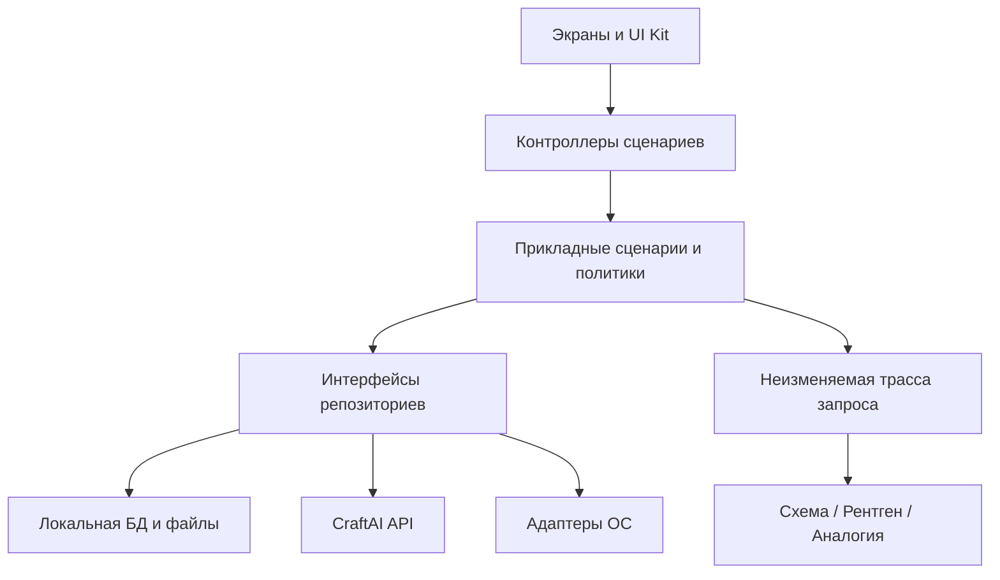
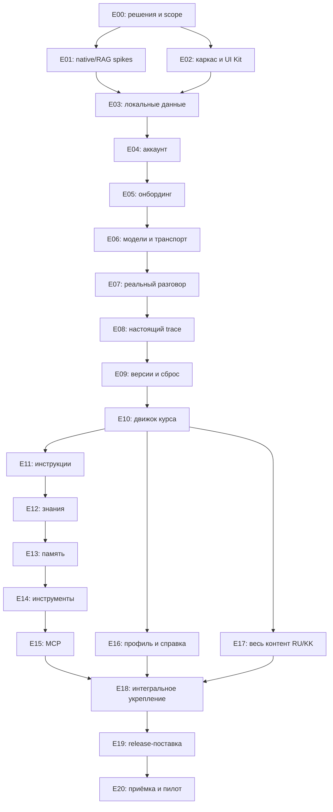

# Craft Builder — полный план реализации на Flutter

**Дата:** 17 октября 2026 года.

**Статус:** план работ; не отчёт о реализованных функциях.

**Продукт:** самостоятельное приложение `Builder` для iOS и Android.

**Исходная ревизия:** `59d4e452de765b60729e02d81dee85ff12416da6`, ветка `main` (включая новый визуальный лист User flow).

**Место документа:** существующий каталог документации `Builder/docs/Plan/`.

**Граница текущего изменения:** только этот Markdown-файл. Реализация перечисленных задач, изменение приложения и подключение сервисов этим документом не выполняются.

## Содержание

1. [Источники, приоритеты и исходное состояние](#sources)
2. [Результат, состав поставки и границы MVP](#scope)
3. [Противоречия и обязательные продуктовые решения](#decisions)
4. [Целевая архитектура Flutter](#architecture)
5. [Данные, локальное хранение и жизненный цикл](#data)
6. [Контракты CraftAI и границы ответственности](#contracts)
7. [Машины состояний и инварианты](#invariants)
8. [Карта экранов и маршрутов](#screens)
9. [План развития UI Kit и персонажа](#design)
10. [Этапы реализации E00–E20](#execution)
11. [Контент курса и результаты уровней](#curriculum)
12. [Русский, казахский и доступность](#localization)
13. [Инструменты и особенности платформ](#platforms)
14. [Приватность, безопасность и удаление](#privacy)
15. [Офлайн, восстановление и обновления](#offline)
16. [Производительность и наблюдаемость](#performance)
17. [Проверки и сценарии приёмки](#quality)
18. [CI/CD и выпуск](#delivery)
19. [Зависимости, контрольные точки и порядок поставки](#milestones)
20. [Риски и блокирующие решения](#risks)
21. [Критерии полной готовности MVP](#done)
22. [Работы после MVP](#future)
23. [Матрица трассировки всех требований](#traceability)
24. [Первые задачи для начала разработки](#first-tasks)

<a id="sources"></a>
## 1. Источники, приоритеты и исходное состояние

### 1.1. Прочитанные источники

| Источник | Что определяет |
|---|---|
| [Функциональные требования](../functional-requirements.md) | 122 требования FR и 13 требований NFR, ограничения интеграций, сущности и приёмку |
| [Требования к дизайну](../craft-builder-design-brief.md) | Экраны, компоненты, состояния, размеры, доступность, персонажа |
| [User flow и аудит](../user-flow.md) | Последнюю схему переходов, принадлежность данных вкладкам, удалённые экраны |
| [Визуальный User flow](../../design/Flow.dc.html) | Подписанные переходы, расположение нижней навигации, возврат после общего сброса |
| [Концепция](../craft-builder-concept.md) | Назначение продукта, локальное состояние ассистента, облачный прокси, рамки MVP |
| [Методичка](../methodology.md) | Учебные цели, задания, проверки, рефлексию, содержание пяти уровней |
| [Описание реализованного UI Kit](../ui-kit.md) | Текущие Flutter-компоненты, ограничения демонстрации, принятые решения по доступности |
| [Макеты](../../design/) | UK1–UK4, Char, Main/S10, S00–S56 и D02–D07; визуальный источник для реализации |
| [Текущий Flutter-проект](../../lib/) | Реально существующий код, который нужно развивать, а не проектировать заново |

Заголовки версий в исходных документах местами отстают от их содержимого. Основание этого плана — содержимое файлов указанной ревизии, включая аудит 17.10.2026, а не только номер версии в шапке.

### 1.2. Порядок разрешения расхождений

1. Явные решения последнего аудита и обновлённые FR имеют приоритет над старым прототипом на 16 экранов.
2. Обязательные ограничения продукта и безопасности имеют приоритет над демонстрационными значениями макета.
3. UK1–UK4 определяют внешний вид компонентов; ТЗ определяет доступность и поведение.
4. Текущее поведение каталога UI Kit не считается утверждённым поведением рабочего приложения.
5. Новое решение, которого нет в источниках, обозначается в этом плане как **предложение** или **ADR**, а не как существующее требование.
6. Неустранённое противоречие с влиянием на данные или внешние действия становится условием допуска соответствующего этапа. Оно не решается молча в коде.

### 1.3. Что уже есть

- Самостоятельный Flutter-пакет `builder`, проекты Android/iOS и Web для просмотра.
- Светлая тема, токены, Onest и JetBrains Mono с локальными файлами и лицензиями.
- 24 SVG-иконки, вектор персонажа, представление уровней 0–5 и статических состояний.
- Кнопки, поля, чипы, переключатели, прогресс, навигация, карточки, сообщения и демонстрация подтверждения.
- Интерактивный каталог из четырёх разделов в `lib/gallery/`.
- 22 теста UI Kit: адаптивность, размер целей нажатия, несколько интерактивных сценариев.
- Успешная веб-сборка и проверка каталога в Chromium на предыдущем этапе.

### 1.4. Чего ещё нет и что нельзя считать готовым

- Нет производственной авторизации CraftAI, маршрутизации продукта и полноценного онбординга.
- Нет базы данных, защиты локального хранилища, миграций и раздельных пространств аккаунтов.
- Нет настоящего общения с моделью, streaming-протокола, истории и трассы реального запроса.
- Нет движка курса, настоящего прогресса, версий ассистента и общего сброса.
- Нет обработки PDF/DOCX/TXT, локальных эмбеддингов и индекса RAG.
- Нет рабочих адаптеров календаря, заметок, звонков, сообщений, поиска и MCP.
- Нет полной локализации, native-проверок, подписанных мобильных сборок и выпуска в сторах.
- Демонстрационное ожидание в `BuilderActionCard` не создаёт событие и не доказывает безопасность внешнего действия.
- Отображение статического SVG не означает, что готовы анимации, раскрытие в схему и связь персонажа с доменной моделью.

**Правило:** существующий UI Kit переиспользовать. Производственные данные, состояния и побочные эффекты реализовать отдельно от демонстрационного каталога. `mobile/` не входит в область работ.

<a id="scope"></a>
## 2. Результат, состав поставки и границы MVP

### 2.1. Основной результат

Учитель устанавливает Craft Builder, входит аккаунтом CraftAI, проходит онбординг и пять уровней, настраивает ассистента под предмет, получает реальные ответы, видит состав каждого запроса, управляет своими материалами и подтверждает действия. После перезапуска всё его локальное состояние сохраняется. В приложении явно видно, когда данные покидают телефон.

### 2.2. Обязательная поставка MVP

| Область | Объём |
|---|---|
| Аккаунт | Вход, регистрация, восстановление пароля, выход, удаление аккаунта с подтверждением |
| Онбординг | Предмет, классы, язык ассистента, имя, объяснение облачной обработки до первого запроса |
| Ассистент | Текстовый разговор, история, новый разговор, остановка, ошибки, копирование и доступ к настройкам |
| Модели | Три категории, рабочая по умолчанию, серверная конфигурация конкретной модели |
| Инструкции | Правила, включение/выключение, собранная инструкция, проверка на примере |
| Знания | PDF/DOCX/TXT, локальная обработка и поиск, ссылки на фрагменты, предупреждение при отсутствии опоры |
| Память | Локальные факты, редактирование и удаление; предлагаемое сохранение — после согласия |
| Инструменты | Календарь, заметки/файлы ассистента, подготовка звонка/сообщения, поиск через CraftAI |
| MCP | Один демонстрационный каталог уроков CraftAI, выдача и отзыв доступа, объяснение обмена |
| Под капотом | Схема, рентген и аналогия для одного и того же реального запроса |
| Курс | Пять уровней, пять экранных шагов, проверка практики, возобновление, итог |
| Версии | Автосохранение при подтверждённых изменениях, ручная версия, история, восстановление |
| Общий сброс | Одно локальное действие для ассистента, его данных, версий и прогресса |
| Профиль | Аккаунт, предмет/классы, расход токенов, настройки, приватность, справка |
| Языки и доступность | RU/KK, крупный текст, экранные дикторы, безопасные зоны и платформенный возврат |
| Поставка | Android/iOS, тесты, диагностика без текстов диалогов, инструкция выпуска и восстановления |

### 2.3. Разделение очередей

- **M0 — ядро MVP:** все M/«да» и обязательные NFR; реальные сценарии пяти уровней.
- **M1 — доведение MVP:** S/«да», словарь S27, справка S56, переименование S14, streaming, возобновление и offline-теория. Планировать в общей поставке; исключать только отдельным явным решением.
- **P2 — расширения:** сравнение версий с повторным запуском ответа, достижения, дополнительные виды персонажа, тёмная тема, экспорт серверных данных аккаунта.
- **После MVP:** уровни 6–9, сравнение моделей, Google-коннекторы, кабинет методиста, синхронизация между телефонами, локальный LLM, сервер моделей в Казахстане, полноценная web-версия продукта.

Шаг безопасности в начале курса и защита внешних действий обязательны уже в MVP. Вынесен за его рамки отдельный учебный **уровень 8**, а не базовые меры приватности.

### 2.4. Сопутствующие серверные работы

Полное приложение невозможно завершить только средствами Flutter. В план входят контракты и условия готовности CraftAI: аккаунты, прокси модели, каталог моделей, поиск, демонстрационный MCP, учёт токенов, удаление аккаунта и жалобы. Это зависимости мобильного проекта, а не поручение переписывать сервер в этом репозитории.

<a id="decisions"></a>
## 3. Противоречия и обязательные продуктовые решения

### 3.1. Рабочая трактовка источников

| Расхождение | Решение для планирования |
|---|---|
| Три шага урока в раннем FR-LVL-04, четыре в части подписей, пять в последнем flow | Пять экранных этапов S22 → S23 → S24 → S25 → S26; цель включена в «Идею», рефлексия в «Итог» |
| Четыре формата «Под капотом» в старых абзацах | Три вкладки: Схема / Рентген / Аналогия. Шаги и длительности входят в схему |
| Сравнение моделей в старых заданиях и на S20 | Не включать в MVP. Выбор одной категории остаётся; учебное «до/после» сравнивает умение, а не модели |
| Достижения и прогресс в профиле ранних FR | Данные курса принадлежат «Курсу»; профиль показывает аккаунт и приложение |
| D01 и D06, S34 и S45 ещё встречаются в старых ссылках | Не реализовывать. Подтверждение встроено в чат, сброс один, категории описаны в S33, разрешения показаны у инструментов |
| S03 ведёт сразу в урок в раннем ТЗ | Последний flow: S03 → D02 → S10; первый урок открывается из S10/S20 |
| Body 15 px в UK1 и минимум 16 px в доступности | Сохранить принятое UI Kit значение 16/23; не уменьшать основной текст |
| Неоткрытые модули отсутствуют в тексте ТЗ, но видны на 14% в UK4 | Сохранить текущую визуализацию силуэтом; недоступность обозначать также текстом/замком. Подтвердить с дизайнером до полировки |
| «Уровень 0» у персонажа, а курс начинается с уровня 1 | Не связывать числовой параметр SVG напрямую с прогрессом курса; ввести явное отображение доменного прогресса в модули |
| «Локальный инференс» в старой архитектурной схеме | В MVP нет локального LLM. Локальный embedding-модуль — отдельная технология поиска, а не чат-модель |
| Экспорт аккаунта нарисован, но FR-PRF-07 вне MVP | Точка расширения; рабочую кнопку показывать только при наличии серверного API. Не подменять экспортом ассистента |
| «Остаток токенов» в макете, но пользовательские лимиты не вводятся | Показывать расход за период. Остаток/лимит — только если сервер действительно возвращает такую политику |
| Короткая сессия 10–15 минут и урок 25–40 минут | Урок допускает несколько сессий с сохранением шага; продолжительность контента уточнить с методистом |
| D02 «Не сейчас» ведёт в S10, но облако требует объяснения и подтверждения | Позволить войти в локальную часть S10; отправку в облако блокировать до принятия предупреждения. Точное различие acknowledgment/consent согласовать |
| Чип в UI Kit открывает справочную шторку, а чип S10 ведёт в S55 | Для S10 предусмотреть передаваемое действие перехода в S55; компактные чипы других компонентов могут открывать пояснение |

### 3.2. ADR, которые нужно закрыть до работы с пользовательскими данными

| ADR | Вопрос и предлагаемое направление | Кто подтверждает | До какого этапа |
|---|---|---|---|
| ADR-01 | Восстанавливает ли версия прогресс или только конфигурацию? Предложение: прогресс не откатывать; доступность вычислять из курса, отсутствующие в старой версии умения выключать | Продукт + методист | E09 |
| ADR-02 | Как навсегда удалить документ, если на него ссылается старая версия? Предложение: физическое удаление глобально; исторический снимок не должен тайно восстанавливать удалённый файл | Продукт + приватность | E09/E12 |
| ADR-03 | Как учиться ещё не открытому умению? Предложение: отдельный учебный draft; доступ к практике уровня без глобального обхода блокировок | Продукт + методист | E10 |
| ADR-04 | Что остаётся при выходе/смене аккаунта? Предложение: сохранить зашифрованное пространство, закрыть доступ до повторного входа того же владельца | Продукт + backend | E03/E04 |
| ADR-05 | Срок хранения истории и traces; поведение переключателей S15; запрет записи в историю без отключения чата | Продукт + приватность | E03/E07 |
| ADR-06 | Что означает отказ D02, срок актуальности подтверждения и отдельное предупреждение для поиска | Продукт + юрист | E05/E06 |
| ADR-07 | Локальные embeddings/индекс на средних Android и iOS, лицензия и размер модели; допустимость альтернативы | Flutter + ML | E01, до E12 |
| ADR-08 | Минимальные ОС, устройства для пилота, ограничения памяти/хранилища, PDF-сканы и лимиты файлов | Flutter + продукт | E01 |
| ADR-09 | Порог зачёта и обязательные действия каждого уровня; проверка только на локальных свидетельствах без оценки личных ответов моделью | Методист | E10/E17 |
| ADR-10 | Какие записи включать в контекст, как отделить персонализацию UI от «чистой» модели после сброса | Продукт + Flutter | E07/E09 |
| ADR-11 | Удаление аккаунта, отзыв токенов, доступ к локальному ассистенту после удаления, судьба уже созданных внешних событий | Продукт + backend | E16/E18 |
| ADR-12 | Жалоба на ответ: текст не хранится сервером по умолчанию; отдельная осознанная отправка выбранного фрагмента либо жалоба только по ID/метаданным | Backend + приватность | E07/E18 |

Решения ADR оформить перед зависимой реализацией. В этом плане они перечислены как будущие артефакты; дополнительные файлы ADR сейчас не создаются.

<a id="architecture"></a>
## 4. Целевая архитектура Flutter

### 4.1. Принципы

- Feature-first структура; внутри функционального блока разделять представление, прикладные сценарии и доступ к данным.
- Бизнес-правила не размещать в `build()`, галерее, сетевом DTO или платформенном плагине.
- Источник пользовательского состояния — локальное хранилище, а не состояние виджетов и не CraftAI.
- Любое облачное обращение проходит через CraftAI; провайдер OpenRouter не доступен из мобильного кода напрямую.
- Один конвейер собирает контекст и trace. Экран «Под капотом» не собирает вторую, приблизительную версию запроса.
- Права уровня, разрешения ОС, включённость инструмента, актуальность подтверждения и возможности модели проверяются раздельно.
- Production, локальная демонстрация и тестовые fake-адаптеры явно различаются.
- Модули `Builder` не импортируют исходники, настройки или ассеты `mobile`.

### 4.2. Предлагаемый стек

Выбор пакетов — **предложение**. До добавления проверить актуальность, лицензию, поддержку ОС, privacy manifests и совместимость с SDK. Версии фиксировать в lockfile после проверки.

| Задача | Предлагаемое решение | Что проверить |
|---|---|---|
| Состояние и DI | Riverpod с отдельными контроллерами сценариев | async-потоки, изоляцию scopes при смене аккаунта, тестовые overrides |
| Маршруты | `go_router`, отдельные navigator stacks трёх вкладок | guards, возврат из шторок, deep links восстановления пароля |
| HTTP | Dio либо `http` с выделенным streaming-клиентом | отмену, incremental decoding, refresh без гонок, запрет логирования тела |
| Сущности и DTO | Immutable Dart-модели; при необходимости Freezed/json_serializable | объём генерации, сериализацию мигрируемых снимков |
| Локальная БД | Drift/SQLite за repository-интерфейсами | транзакции, FTS, выбранный механизм шифрования, миграции |
| Секреты | Keychain/Android Keystore через secure-storage адаптер | аппаратную защиту, backup/restore, переустановку, блокировку устройства |
| Файлы | Приватные application-support каталоги, `path_provider`, file-picker | scoped storage, security-scoped URL на iOS, временные копии |
| Поиск | Локальный parser → chunks → embeddings → индекс | реалистичность на устройствах, русский/казахский, отмену и удаление |
| Платформенные действия | Малые адаптеры календаря, системного chooser/compose, контактов | фактические разрешения, ограничения iOS/Android и статусы результата |
| Локализация | Flutter `gen_l10n`, ARB, `intl`, locale `ru`/`kk` | казахские буквы, plural/date/time, длину строк |
| Отображение | Существующий UI Kit, `flutter_svg`, локальные шрифты | воспроизводимость, доступность, семантику и производительность |
| Разметка ответов | Ограниченный Markdown-рендерер | безопасные ссылки, отсутствие исполняемого HTML/JS, code blocks |
| Напоминания | Локальные уведомления после отдельного разрешения | часовые пояса, отмену, отсутствие жёсткой зависимости курса от разрешения |
| Диагностика | Структурированные технические события, адаптер crash-reporting | исключение текста, секретов, персональных имён и путей файлов |

Не вводить Firebase/облачную БД для хранения ассистента, общий глобальный mutable-store и отдельный state-manager для каждого экрана. HTTP/WebSocket/SSE выбрать по реальному контракту CraftAI; ниже используется SSE-подобный поток как проектный вариант.

### 4.3. Предлагаемая структура кода

```text
Builder/
  lib/
    main.dart
    app/
      bootstrap.dart
      app.dart
      router/
      environment/
      localization/
    core/
      database/
      files/
      network/
      security/
      lifecycle/
      permissions/
      errors/
      diagnostics/
    ui_kit/                  # сохраняем существующую библиотеку
    gallery/                 # отдельный dev-вход, без production-зависимости
    features/
      auth/
      onboarding/
      assistant/
      conversations/
      generation/
      under_hood/
      instructions/
      knowledge/
      memory/
      tools/
      connections/
      versions/
      course/
      glossary/
      profile/
      settings/
      privacy/
      support/
    shared_domain/
      assistant_snapshot.dart
      capability_policy.dart
      request_trace.dart
      workspace_identity.dart
  assets/
    fonts/
    icons/
    character.svg
    course/                  # versioned RU/KK content, sample documents
  test/
    domain/
    repositories/
    features/
    ui_kit/
  integration_test/
```

Это целевая структура, а не команда немедленно создать пустые каталоги. Добавлять функциональный блок вместе с реальным сценарием и тестами.

### 4.4. Потоки зависимостей



Репозиторий состояния ассистента, движок генерации и движок курса могут зависеть от общих доменных контрактов, но не от экранов друг друга. Персонаж получает готовую view-model, а не обращается к БД/сети.

<a id="data"></a>
## 5. Данные, локальное хранение и жизненный цикл

### 5.1. Разделение данных

| Область | Содержимое | Хранение |
|---|---|---|
| Аккаунт | CraftAI user ID, имя/e-mail, техническое потребление | CraftAI; минимальный локальный кэш профиля |
| Сессия | Access/refresh-токены, состояние восстановления входа | Защищённое хранилище устройства |
| Пространство ассистента | Конфигурация, версии, разговоры, память, документы, прогресс | Только телефон, раздельно по владельцу |
| Контент | Уроки, вопросы, аналогии, справка, словарь, демонстрационные файлы | Versioned bundle и локальный кэш |
| Серверные справочники | Категории/модели, возможности, конфигурация MCP, лимиты документов | CraftAI + валидируемый кэш |
| Трассы | Реальный контекст, найденные фрагменты, вызовы и результаты | Локально, с определённым сроком хранения |
| Техническая диагностика | Коды ошибок, длительности, версии компонентов | Минимально; без содержания диалогов |

Обозначение «состояние не передаётся на сервер» означает отсутствие серверного хранилища ассистента. Части инструкции, памяти и найденные фрагменты всё равно входят в облачный запрос; это обязательно показывается пользователю.

### 5.2. Сущности и связи

| Сущность | Минимальные поля и связи |
|---|---|
| `Workspace` | ID владельца CraftAI, installation ID, schema version, generation/epoch, createdAt |
| `TeacherPreferences` | Предмет, классы, язык интерфейса, язык ассистента, напоминания, настройки хранения |
| `AssistantConfiguration` | Имя, выбранная категория, включённые умения, правила и ревизия состояния |
| `InstructionRule` | ID, группа, текст, enabled, порядок, источник, revision |
| `AssistantVersion` | Монотонный номер, дата, причина, parent ID, schema version, immutable snapshot |
| `Conversation` | ID, owner, название, createdAt, activityAt, политика хранения |
| `Message` | Роль, текст, состояние, conversation ID, request ID, версия ассистента, время |
| `GenerationRequest` | ID, снимок контекста, category/model revision, status, cancellation, trace ID |
| `RequestTrace` | Слои контекста, отправленные фрагменты, usage, времена, ошибки, действия |
| `KnowledgeDocument` | ID, content hash, безопасное имя, формат, размер, enabled, parse/index status |
| `DocumentRevision` | Неизменяемый текст/manifest, parser version, embedding model ID, ссылки на blob |
| `KnowledgeChunk` | Document revision ID, chunk ID, текст, страница/раздел, смещения, embedding metadata |
| `MemoryFact` | ID, текст, source, enabled, createdAt/updatedAt; состояние предложенного сохранения |
| `ToolGrant` | Имя инструмента, включённость, область разрешения, revision; не равно разрешению ОС |
| `PendingAction` | Invocation ID, валидированные параметры/hash, owner/epoch, версия, сроки и статус согласия |
| `ToolInvocation` | Источник вызова, аргументы, начало/конец, результат, OS/server execution ID |
| `ConnectorBinding` | Коннектор, выданные capabilities, enabled, revocation revision, data location |
| `CourseContentVersion` | Язык, версия bundle, manifest, совместимость схемы, опубликованность |
| `LessonProgress` | Level ID, content version, step, checkpoint, evidence, attempts, завершение |
| `LearningDraft` | Исходная версия, изменения практики, scope урока, сохранённые тестовые запросы |
| `QuizAttempt` | Question revision IDs, ответы, объяснения, score, threshold, completedAt |
| `GlossaryEntry` | Stable ID, RU/KK term, определение, level ID, ссылки |
| `LocalNote` | ID, заголовок/текст, source invocation, revision, локальное время |

### 5.3. Требования к реализации хранения

- UUID/аналогичные стабильные ID; даты хранить в UTC, представлять в локали и часовом поясе пользователя.
- Все чтения и изменения фильтровать по активному `Workspace`, включая кэш поиска и изображения.
- Разделить временные файлы, приватные исходники, производные данные, immutable version manifests и публичный bundle курса.
- Для операций «конфигурация + версия + прогресс» использовать транзакцию. Падение не должно оставлять половину зачтённого уровня.
- Бинарные файлы и БД согласовывать через staging/manifest и журнал завершения, поскольку файловая операция не входит в SQLite-транзакцию.
- Для миграции иметь fixture предыдущей схемы, резервную копию на время операции, проверку результата и понятную ошибку без молчаливого сброса.
- Для индекса хранить embedding model ID/версию и параметры chunking. Смена модели требует перестроения, а не смешивания несовместимых векторов.
- SQLCipher или другой механизм шифрования подтвердить прототипом. Обычный Drift/SQLite сам по себе не обеспечивает шифрование содержимого.
- ОС-защиту файлов, ключи и политику backup проверить отдельно для iOS и Android; чувствительные производные файлы защищать так же, как оригиналы.
- Не передавать состояние ассистента через iCloud/Android Auto Backup, если обещано отсутствие переноса. Обработать восстановление данных без ключей.
- Учитывать, что Keychain на iOS может пережить переустановку. Fresh-install detection не должен открыть старое пространство автоматически.
- Не применять `shared_preferences` для диалогов, документов, версий и токенов.

### 5.4. Версии, физическое удаление и исторические данные

1. Снимок версии содержит конфигурацию и ссылки на неизменяемые ревизии ресурсов, а не произвольные пути к изменяемым файлам.
2. Отключение документа и физическое удаление — разные действия. Отключённый документ не участвует в новых запросах.
3. Физическое удаление должно удалить файл, текст, chunks, embeddings, индекс и временные копии в соответствии с утверждённой политикой.
4. Старые traces могут содержать уже отправленные фрагменты: политика удаления обязана явно охватывать их либо честно объяснять остаточное хранение до подтверждения.
5. Откат не должен тайно возвращать навсегда удалённые персональные материалы. Для снимков с удалёнными ссылками показать недоступность/частичное восстановление только по утверждённому ADR-02.
6. До утверждения этой политики нельзя обещать «точное восстановление любой версии» и одновременно «полное удаление документа».
7. Восстановление не вызывает календарь/MCP повторно, не отправляет прежние сообщения и не возвращает разрешения, уже отозванные в ОС или сервисе.

<a id="contracts"></a>
## 6. Контракты CraftAI и границы ответственности

### 6.1. Обязательные серверные возможности

Представленная таблица — проект контракта. Конкретные URI, JSON и коды ошибок согласовать с существующим CraftAI; не считать их уже работающими API.

| Контракт | Вход/результат | Условия для Flutter |
|---|---|---|
| Регистрация и вход | Имя/e-mail/пароль → user + session | Общий аккаунт CraftAI; единая ошибка неверных данных |
| Refresh/logout | Refresh token/сессия → новые токены/отзыв | Single-flight refresh, защита от устаревших ответов |
| Reset password | E-mail → письмо; одноразовый link token → новый пароль | Проверка scheme/host, срока, повторного использования |
| Profile | Профиль, допустимые поля и настройки | Явно разделить серверные и локальные поля |
| Model catalog | Категории, capabilities, текущие model IDs, revisions, доступность | Кэш, расширяемость, отсутствие зашитого провайдера |
| Generation | Собранный контекст, инструменты, request ID → поток событий | Отмена, request correlation, usage, model ID, ошибки |
| Tool continuation | Tool-call ID + подтверждённый результат → продолжение того же запроса | Связь с исходной трассой, ограничения циклов |
| Web search | Только разрешённый поисковый запрос → результаты/источники | Явная облачная маркировка, таймаут и отзыв доступа |
| MCP gateway | Каталог tools/list и tools/call разрешённого коннектора | Без произвольного внешнего URL с телефона |
| Usage | Расход аккаунта за период, timestamp, единицы | Без выдуманного лимита/денежного баланса |
| Account deletion | Повторное подтверждение → статус удаления/отзыва сессий | Отдельно от локального D05 |
| Report answer | Report ID/метаданные, при согласии — выбранный текст | Без автоматической отправки всего диалога |
| Account export | Профиль и usage, если включён соответствующий этап | Не включать локальный ассистент в серверный архив |
| Operational config | Лимиты документов, поддерживаемые форматы, политики, версии | Без произвольного исполняемого кода и скрытых функций |

### 6.2. Поток генерации

Предложить типизированные события: начало запроса, текстовая дельта, начало/дельта/завершение tool-call, usage, завершение, отмена, ошибка. Добавить `requestId`, `eventId/sequence`, версию схемы, actual model ID и причину завершения.

- Декодировать UTF-8 и границы событий инкрементально: один сетевой chunk не равен событию или символу.
- Частичные JSON-аргументы инструмента не исполнять до полного завершения и проверки схемы.
- Повторный event ID не должен повторять текст, карточку подтверждения или внешнее действие.
- При разрыве сохранять неполный ответ со статусом «прервано», а не «готово».
- Повторное подключение по cursor/event ID реализовать только при серверной поддержке replay; иначе предложить явный повтор нового запроса.
- После stop отменять подписку/HTTP, завершать локальное состояние и игнорировать поздние события по request ID/epoch.
- Usage и фактическую модель брать из ответа сервера. Оценку токенов на клиенте обозначать как оценку.
- Не реализовывать бесконечный автоматический цикл function calling под видом уровня 5. Установить ограниченный tool-loop и время выполнения, без интерфейса агента уровня 9.

### 6.3. Условия готовности серверной части

- [ ] Описаны OpenAPI/схемы потока и унифицированные domain error codes.
- [ ] Есть тестовое окружение, отдельные тестовые аккаунты и известные параметры окружения.
- [ ] Подтверждены таймауты, cancellation и поведение usage после прерванной генерации.
- [ ] Набор моделей реально проверен на RU/KK, включая function calling; модели заменяются конфигурацией.
- [ ] Ключ OpenRouter хранится только сервером; в бинарниках, remote config и crash dumps его нет.
- [ ] HTTP-прокси, reverse proxy, APM, tracing и error tracking не сохраняют тела диалогов по умолчанию.
- [ ] Настройки хранения и обработки сторонних провайдеров согласованы и описаны пользователю; обещание «CraftAI не хранит» не выдается за гарантию всех провайдеров.
- [ ] Поиск и MCP возвращают реальные происхождение, данные и длительности для trace.
- [ ] Удаление аккаунта/отзыв сессий работает на сервере, а не только очищает клиентский экран.
- [ ] Защитные технические лимиты транспорта/действий отделены от отсутствующих в MVP тарифных квот пользователя.

<a id="invariants"></a>
## 7. Машины состояний и инварианты

### 7.1. Сессия и запуск

```text
bootstrap → storage migration → session restore
  → signedOut → login/register/reset password
  → authenticated + no local onboarding → onboarding
  → authenticated + onboarding complete → Assistant tab
  → no network + valid cached local workspace → restricted offline mode
```

Истёкший сетевой токен не должен автоматически стирать локальную БД. Политику offline-доступа после истечения сессии определить явно: что можно читать, когда нужен повторный вход и как исключается доступ другого владельца.

### 7.2. Один запрос

```text
idle → validating → collecting context → connecting → streaming
  → completed
  → awaiting confirmation → executing tool → continuing → completed
  → cancelled / failed / interrupted
```

Инварианты:

- В начале захватывается immutable snapshot конфигурации и выбранной модели. Изменение настроек влияет на следующий запрос.
- В trace и реальном payload используются одни и те же instruction/memory/chunk/tool manifests.
- Отменённый запрос, старый аккаунт, отозванное подключение или предыдущий reset epoch не могут дописать ответ в активное пространство.
- Локальная ошибка после внешнего действия не даёт оснований повторить действие автоматически.
- Результат, достоверность которого неизвестна, обозначается как неизвестный; успешный текст модели не заменяет подтверждение адаптера.

### 7.3. Урок и разблокировка

```text
locked → available → idea → practice → underHood → check
  → check failed → retry practice/check
  → passed → summary → completed
```

- Права на умения вычисляются доменной политикой из подтверждённого прогресса; UI не является границей доступа.
- Закрытый уровень не становится рабочим от прямой ссылки, восстановления старого route или изменения локального флага виджета.
- Учебный draft позволяет попробовать целевое умение в S23; перенос в рабочий ассистент и выдачу постоянной capability согласовать через ADR-03.
- Возобновление хранит конкретный шаг, content version, quiz attempt и evidence, а не только номер уровня.
- Повтор уже пройденного урока не выдаёт дублирующий зачёт и не создаёт несколько одинаковых итоговых версий.
- Сохранение результата практики, итоговой версии и зачёта выполняется атомарно/с восстанавливаемым commit marker.

### 7.4. Подтверждение внешнего действия

```text
proposed → validated → awaiting user
  → confirmed → revalidated → executing → succeeded
  → cancelled / expired / revoked
  → failed / resultUnknown
```

Карточка согласия привязана к owner, epoch, tool-call ID и hash параметров. Изменение времени, получателя, текста или календаря аннулирует старое согласие. Перед исполнением повторно проверяются capability, включённость, разрешение ОС/коннектора и актуальность версии.

После перезапуска незавершённое подтверждение не исполняется само. Для server-side операций использовать idempotency key, для native-календаря — устойчивую запись соответствия invocation ↔ external event ID и стратегию проверки результата. Открытие системного compose-окна означает «подготовлено», а не «сообщение отправлено».

### 7.5. Сброс

```text
request reset → strong confirmation → freeze new work → cancel in-flight
  → revoke pending actions → advance workspace epoch
  → transactional logical reset → recoverable file cleanup → baseline
```

Сброс удаляет локальные инструкции, документы/индексы, память, разговоры согласно согласованной политике, подключения, версии и результаты курса. Аккаунт CraftAI, серверный расход и уже созданные внешние события не удаляются. Политика сброса имени, категории, предмета и языка отдельно описывается в ADR-10; никакая персонализация не должна скрыто попадать в «чистый» запрос.

<a id="screens"></a>
## 8. Карта экранов и маршрутов

Маршруты ниже — предложение для `go_router`. Идентификаторы S/D сохраняются для сверки с макетами. Историю стека каждой вкладки сохранять; lesson/player и модальные слои не должны создавать четвёртую вкладку. По листу Flow нижняя панель видна на S10, S11, S20, S27, S50, S54–S56; на S53 — только после включения достижений. Остальные экраны открываются поверх и закрываются «Назад»/×. Миниатюры Flow хранятся в Design-артефакте, поэтому локально опираться также на подписанные переходы и исходные макеты, а не считать отсутствие загруженной миниатюры отсутствием экрана.

| ID | Экран / маршрут | Обязательные состояния и действия | Этап |
|---|---|---|---|
| S00 | Вход `/auth/login` | Loading, invalid credentials, offline; показ пароля, RU/KK, регистрация, восстановление | E04 |
| S00 | Регистрация `/auth/register` | Политики, требования пароля, duplicate e-mail, сохранение полей без пароля в логах | E04 |
| S00 | Восстановление `/auth/recovery` и reset deep link | Письмо, истёкшая/использованная ссылка, новый пароль | E04 |
| S01 | Знакомство `/onboarding/welcome` | Базовый персонаж, три тезиса, следующий шаг | E05 |
| S02 | Предмет `/onboarding/preferences` | Поиск/«Другое», классы 1–11, RU/KK/оба, сводка | E05 |
| S03 | Имя `/onboarding/assistant` | Имя по предмету, редактирование, базовое состояние, переход D02 | E05 |
| D02 | Данные за рубежом | Принятие/отсрочка, версия предупреждения, локальный доступ без облачной отправки | E05/E06 |
| S10 / Main | Разговор `/assistant` | Empty, connecting, streaming, tool waiting, slow, stopped, error, offline, context limit | E07 |
| — | История `/assistant/conversations` | Локальный список, открытие, новый разговор, политика удаления | E07 |
| S11 | Настройки `/assistant/settings` | Персонаж/схема, возможности по уровням, ссылки на умения/модель/версии/данные | E09 |
| S12 | Версии `/assistant/versions` | Текущая, история, сохранение, предварительное описание отката, D04 | E09 |
| D04 | Подтверждение восстановления | Что вернётся, что сохранится, недоступные ресурсы, отмена | E09 |
| S14 | Имя `/assistant/name` | Валидация, превью, отмена/сохранение, изменение версии по политике | E09 |
| S15 | Данные `/assistant/data` | Политики истории/документов, локальное хранение, единственный D05 | E09/E18 |
| D05 | Начать заново | Полный перечень, сильное подтверждение, прогресс очистки, восстановление после сбоя | E09/E18 |
| S31 | Под капотом `/trace/:requestId` как слой | Схема/Рентген/Аналогия, слои, источники, usage, неполная/недоступная trace | E08 |
| S33 | Категория `/assistant/model` | Три категории, текущая, недоступность, offline-выбор, отдельные data labels | E06/E09 |
| S40 | Инструкции `/assistant/instructions` | Пусто, правила, raw preview, лимит, тест, draft, сохранение | E11 |
| S41 | Знания `/assistant/knowledge` | Empty, staged/parsing/indexing/ready/failed, search hit/miss, удаление | E12 |
| D03 | Проверка персональных данных | Напоминание до импорта, продолжить/отмена без передачи файла в облако | E12 |
| S42 | Память `/assistant/memory` | CRUD, предложенный факт, accept/reject, предупреждение | E13 |
| S43 | Инструменты `/assistant/tools` | Три группы, grant, ОС permission, denied/revoked/unavailable, подтверждение в чате | E14 |
| S44 | MCP `/assistant/connections` | Подключено/нет, разрешения, data disclosure, disconnect, показать обмен | E15 |
| D07 | Объяснение разрешения ОС | Зачем нужно, системный запрос, отказ/настройки; реальный OS prompt | E14/E16 |
| S20 | Курс `/course` | Девять карточек, 1–5 действуют, 6–9 «Скоро», resume, всё пройдено, D05 | E10 |
| S21 | Каркас урока `/course/lesson/:levelId/:step` | Выход с сохранением, назад/вперёд, gate, content revision | E10 |
| S22 | Идея | До трёх предложений, короткая схема, старт практики; при обычном шрифте помещается в 390×844 | E10/E17 |
| S23 | Практика | Учебный экран умения, instruction, до/после, evidence, network/model errors | E10–E15 |
| S24 | Под капотом урока | Та же trace, выделен изучаемый модуль; без выдуманных данных | E08/E10 |
| S25 | Проверка | 3–5 вопросов, объяснение, threshold из content, повтор без наказания | E10/E17 |
| S26 | Итог | Один зачёт/снимок, модуль, рефлексия, далее/ассистент/карта | E10/E17 |
| S27 | Словарь `/course/glossary` | Поиск RU/KK, level, определение, переход в урок, возврат к исходному слою | E16/E17 |
| S50 | Профиль `/profile` | Профиль и usage, cache timestamp/error, настройки/приватность/справка, выход | E16 |
| S54 | Настройки `/profile/settings` | Язык UI, предмет/классы, напоминания, системный масштаб, about | E16 |
| S55 | Приватность `/profile/privacy` | Карта данных, предупреждения, удаление аккаунта, экспорт только если доступен | E16/E18 |
| S56 | Справка `/profile/help` | Поиск, FAQ, обращение без автоматического вложения диалогов | E16/E17 |

Дополнительно спроектировать отсутствующие в макетах состояния: удаление аккаунта, refresh/re-login, выбор календаря, неизвестный результат действия, ошибка миграции, нехватка места, недоступный документ исторической версии, недействительная reset-password ссылка. Применять существующий UI Kit; новые самостоятельные разделы меню не добавлять без необходимости.

Для перехода S10 → S55 хранить источник открытия и корректно возвращать пользователя в разговор. Для термина из S31/S24 словарь открывать так, чтобы закрытие возвращало в тот же ответ/шаг.

**Не включать в маршруты MVP:** D01, D06, S32, S34, S35, S36, S45, S46–S49, S13, S53. Для S13/S53 сохранить отдельные задачи после решения об объёме; старые deep links должны безопасно возвращать пользователя, а не обходить ограничения.

<a id="design"></a>
## 9. План развития UI Kit и персонажа

### 9.1. Сохранить и подключить

- [ ] Переиспользовать `BuilderTheme`, токены, локальные шрифты, оригинальные SVG и семантические цвета.
- [ ] Сохранить каталог как отдельный dev-entry/route, не как главный экран production-сборки.
- [ ] Убрать из production зависимость от mock-данных и демонстрационных callback.
- [ ] Подключать виджеты к контроллерам через явные параметры, не встраивать backend/БД внутрь UI Kit.
- [ ] Локализовать встроенные строки компонентов: loading, tooltip, empty/error и data-location explanations.
- [ ] Расширить поведение чипов callback-параметром для разных контекстов, в том числе перехода S10 → S55.

### 9.2. Доработать библиотеку под рабочие экраны

- [ ] Многострочный/потоковый Markdown-ответ, безопасные внешние ссылки, copy/error/stop и расширенные tool attachments.
- [ ] Шапку S10 с настоящим именем, версией, моделью и состоянием, а не статическими подписями.
- [ ] Корректное scroll-поведение чата: автопрокрутка только у нижнего края, счётчик новых сообщений при чтении выше.
- [ ] Production confirmation card, управляемую внешней state machine; не полагаться на локальный `_result` демонстрационного виджета.
- [ ] Поля пароля, password visibility, multi-select классов, выбор языка, согласие с политиками.
- [ ] Компоненты source citation, document progress/error, memory suggestion, version diff-summary.
- [ ] Ограничение контекста с объяснением и переходом к новому разговору.
- [ ] Скелетоны, offline-баннер, медленная генерация, отсутствие разрешения, отсутствующий resource в версии.
- [ ] Контраст и hit areas при disabled/busy/focused/selected; клавиатурный фокус на web-preview.

### 9.3. Персонаж

- [ ] Ввести `CharacterViewState`, вычисляемый из прогресса, включённых модулей и текущего request/tool state.
- [ ] Разделить доменный уровень курса, число завершённых уровней и визуальный уровень SVG. После общего сброса показывать базовую форму.
- [ ] Проверить соответствие модулей UK4: имя/антенна, инструкции/датчик, знания/книга, память/плашка, инструменты/ноги.
- [ ] Для compact-вида 32/48 px использовать голову без обрезанных краёв; в крупном виде показывать различимые модули.
- [ ] Включённое/выключенное/закрытое передавать не только opacity: подпись, замок, доступность действия.
- [ ] Связать «думает», «действует», «ждёт подтверждения», «не уверен» с реальными событиями. «Не уверен» не выдавать за вычисленную вероятность истинности.
- [ ] Спроектировать смену состояний, вставку нового модуля и раскрытие в схему; формат (Flutter animation/Lottie/другой) выбрать с дизайнером по размеру и производительности.
- [ ] Добавить статические альтернативы для reduced motion; не полагаться на анимацию для передачи результата.
- [ ] Состояние «слушает» оставить в системе дизайна, но не создавать MVP-запись звука и не запрашивать микрофон.
- [ ] Подготовить фирменные app icons/splash для Android и iOS из утверждённого вектора, без временной шаблонной иконки.

<a id="execution"></a>
## 10. Этапы реализации E00–E20

Все задачи ниже — **предстоящая работа**. Чекбоксы закрывать по проверяемому результату, а не по наличию экрана. Этапы могут идти с перекрытием после стабилизации контрактов; зависимости обязательны.

### E00. Уточнить границы, решения и готовность к разработке

**Цель:** получить один согласованный baseline, исключающий противоречивую реализацию.

- [ ] E00-01. Зафиксировать baseline FR/NFR, flow, макетов и текущего кода; выделить изменения после него.
- [ ] E00-02. Принять таблицу приоритетов M0/M1/P2 и отдельный список после MVP.
- [ ] E00-03. Закрыть ADR-01/02/03 о версиях, физическом удалении и учебном draft.
- [ ] E00-04. Разделить согласия D02/D03, разрешения инструмента и OS permission; определить сроки и повторное подтверждение.
- [ ] E00-05. Утвердить все недостающие экраны/состояния из раздела 8.
- [ ] E00-06. Назначить владельцев backend, контента RU/KK, дизайна, проверки устройств и выпуска.
- [ ] E00-07. Определить комплект тестовых материалов без персональных данных: PDF/DOCX/TXT, календарь, аккаунты, каталог уроков.
- [ ] E00-08. Разделить критичные неизвестные, которые блокируют код, и решения, которые можно уточнить в ходе пилота.

**Артефакты:** утверждённый scope, журнал ADR, актуальная матрица экранов и условий приёмки.

**Выход:** для каждой критичной неоднозначности есть решение или явно обозначенный блокируемый этап. Код функций с неопределённой семантикой не начинается.

### E01. Проверить технические риски на устройствах

**Зависимость:** E00; результаты нужны до выбора постоянного storage/RAG/OS stack.

- [ ] E01-01. Поднять существующий Builder на реальном Android и iPhone, не только в браузере.
- [ ] E01-02. Зафиксировать минимальные ОС после проверки актуальных требований Flutter, embedding runtime и плагинов. Не назначать версии ОС по предположению.
- [ ] E01-03. Проверить защищённую БД, ключи, миграции, backup exclusion и переустановку.
- [ ] E01-04. Проверить extract текста PDF/DOCX/TXT с кириллицей, казахским, таблицами и повреждёнными файлами.
- [ ] E01-05. На среднем Android и iPhone измерить локальную embedding-модель и поиск: время, RAM, размер, нагрев, потребление батареи.
- [ ] E01-06. Проверить FTS/vector index и поведение при отмене/удалении во время индексации.
- [ ] E01-07. Проверить native-календарь: чтение, доступные календари, создание, отказы и идентификацию уже созданного события.
- [ ] E01-08. Проверить системную подготовку звонка/SMS, отмену, отсутствие обработчика и различия результатов iOS/Android.
- [ ] E01-09. Прогнать минимальный поток CraftAI: текст, fragmented events, stop, usage и tool-call с native-результатом.
- [ ] E01-10. Проверить качество RU/KK на согласованном наборе задач и выбранных категориях моделей с backend-командой.

**Артефакты:** короткий technical feasibility report и решения по библиотекам; измерения привязаны к устройству/сборке.

**Выход:** критичный сценарий «локальный документ → найденный фрагмент → реальный облачный ответ с trace» технически подтверждён. Если нет — пересмотр ADR-07 до разработки S41; переход на облачные embeddings не выполняется молча.

### E02. Создать производственный каркас приложения

**Зависимость:** E00, базовые результаты E01.

- [ ] E02-01. Выделить bootstrap, окружения dev/staging/prod и production `App`, сохранив UI Kit.
- [ ] E02-02. Подключить согласованный state management/DI, типизированные ошибки и конфигурацию.
- [ ] E02-03. Настроить маршрутизатор с тремя вкладками, root overlays и auth/onboarding guards.
- [ ] E02-04. Создать repositories/use cases, необходимые для первого вертикального сценария; не создавать пустую архитектуру на все будущие уровни.
- [ ] E02-05. Перенести UI Kit catalog в dev-entry; обозначить fake mode, исключить его случайное включение в release.
- [ ] E02-06. Добавить платформенные capabilities: доступно/недоступно, вместо проверок `Platform.is...` по всему UI.
- [ ] E02-07. Настроить ARB/`gen_l10n` сразу, до размножения строк в экранах.
- [ ] E02-08. Отделить operational config от секретов; API base URL — конфигурация, ключ OpenRouter — никогда клиентская настройка.

**Приёмка:** приложение корректно стартует в каждом окружении, route guards проверяются тестами, UI Kit остаётся доступным разработчику, production не использует его демо-контроллеры.

### E03. Реализовать локальную модель данных и изоляцию владельцев

**Зависимость:** E01/E02, ADR-04/05.

- [ ] E03-01. Описать schema version 1 для workspace, конфигурации, версий, разговоров, traces, документов, памяти, grants и курса.
- [ ] E03-02. Создать repository-контракты и маппинг domain ↔ persistence, не используя backend DTO как таблицы БД.
- [ ] E03-03. Реализовать atomic writes и журнал согласования БД с файлами.
- [ ] E03-04. Ввести owner/installation ID и `workspaceEpoch`; исключить смешивание данных двух аккаунтов.
- [ ] E03-05. Подключить проверенное шифрование/OS file protection и защищённое хранение ключа.
- [ ] E03-06. Реализовать закрытие активного пространства и очистку in-memory caches при выходе.
- [ ] E03-07. Реализовать миграции и recovery screen при ошибке, без скрытого `deleteDatabase()`.
- [ ] E03-08. Обработать нехватку места, недоступный ключ, повреждение файла и прерванный write.
- [ ] E03-09. Создать fixture старой схемы для последующих миграционных тестов.

**Приёмка:** рестарт сохраняет данные; другой аккаунт их не видит; ошибка операции не повреждает активный snapshot; оригиналы и производные материалы защищены и удаляемы.

### E04. Подключить аккаунт CraftAI

**Зависимость:** E02/E03, auth-контракт backend.

- [ ] E04-01. Реализовать вход, регистрацию с условиями/политикой, валидацию и показ/скрытие пароля.
- [ ] E04-02. Реализовать единое сообщение ошибки неверного e-mail/пароля, duplicate registration и отказ сети.
- [ ] E04-03. Сделать восстановление пароля: запрос письма, подтверждение отправки, app/universal link, новый пароль.
- [ ] E04-04. Проверять host/scheme, истечение и одноразовость reset token на backend; не логировать URL с токеном.
- [ ] E04-05. Реализовать secure token storage, single-flight refresh, отзыв, logout и истёкшую сессию.
- [ ] E04-06. После входа открывать workspace того же владельца и определять локальное завершение онбординга.
- [ ] E04-07. При offline/refresh error не зацикливать переходы, не стирать ассистента, не показывать данные другому владельцу.
- [ ] E04-08. Не добавлять Google/Apple login и обязательное подтверждение e-mail, если этого нет в согласованном контракте.

**Приёмка:** реальные сценарии CraftAI работают на обеих платформах; восстановление по валидной/просроченной ссылке проверено; секреты не попадают в БД общего назначения и логи.

### E05. Реализовать оболочку, онбординг и первое согласие

**Зависимость:** E04.

- [ ] E05-01. Собрать S01–S03 из production UI Kit: тезисы, предмет, классы, языки и имя.
- [ ] E05-02. Предзаполнять только доступные поля аккаунта; сохранять локальный draft между шагами.
- [ ] E05-03. Поддержать поиск предмета, «Другое», мультивыбор 1–11 и живую сводку.
- [ ] E05-04. Создавать базовый workspace/ассистента однократно; повторный тап «Начать» не дублирует записи.
- [ ] E05-05. Встроить D02 перед первым облачным запросом; сохранить policy version и дату acknowledgment.
- [ ] E05-06. Отсрочку D02 вести в локальную часть, с повторным запросом согласия при попытке отправки.
- [ ] E05-07. Установить «Ассистент» вкладкой по умолчанию; сохранить независимые стеки Курс/Профиль.
- [ ] E05-08. После повторного входа не запускать весь онбординг, если он завершён в том же локальном пространстве.

**Приёмка:** маршрут S00 → S01 → S02 → S03 → D02 → S10 проходит без тупиков; нет скрытой передачи предмета/класса в базовую модель до согласованного включения инструкций.

### E06. Подключить каталог моделей и сетевую основу

**Зависимость:** E02/E04/E05, generation/model contracts.

- [ ] E06-01. Реализовать клиент CraftAI с timeout/cancel, error mapping, request correlation и redaction.
- [ ] E06-02. Загрузить три категории и возможности, отделив category ID от конкретного provider model ID.
- [ ] E06-03. Выбирать рабочую категорию по умолчанию; хранить выбор в локальной конфигурации и версии.
- [ ] E06-04. Собрать S33 с назначением, сравнительными шкалами, доступностью и чипом данных.
- [ ] E06-05. Помечать относительные шкалы как справочные, не как гарантии точности или времени ответа.
- [ ] E06-06. Кэшировать каталог; offline разрешать локальное изменение выбора с понятным ограничением разговора.
- [ ] E06-07. При недоступной категории предлагать альтернативу; не менять модель незаметно и не делать автоматический повтор, увеличивающий стоимость.
- [ ] E06-08. Зафиксировать capabilities и фактическую модель в trace каждого запроса, чтобы последующая смена каталога не переписала историю.

**Приёмка:** backend может заменить конкретную модель без Flutter-релиза; старый ответ продолжает показывать реально использованную модель; в APK/IPA и клиентском трафике нет прямого доступа к OpenRouter.

### E07. Реализовать разговор, историю и конвейер контекста

**Зависимость:** E03/E05/E06; input-контракты будущих instructions/knowledge/memory/tools можно начать с пустых adapters.

- [ ] E07-01. Собрать S10: шапку, empty state, подсказки по предмету, список сообщений, composer, меню нового/истории.
- [ ] E07-02. Реализовать CRUD разговоров и политику хранения истории, включая режим без постоянной записи.
- [ ] E07-03. Создать единый `ContextAssembler`: активная инструкция, выбранные факты, retrieval-фрагменты, доступные tools, релевантная история и запрос.
- [ ] E07-04. Ограничить контекст по реальным capabilities модели; заранее резервировать место под ответ и tool-loop.
- [ ] E07-05. Сохранять immutable context manifest до отправки; текущая конфигурация не меняет уже идущую генерацию.
- [ ] E07-06. Реализовать streaming parser, coalescing обновлений UI, stop/cancel и partial/interrupted сообщения.
- [ ] E07-07. Поддержать безопасный Markdown, источники, code blocks, copy и сохранение в заметку только при доступном инструменте.
- [ ] E07-08. Реализовать offline, медленный ответ >10 секунд, сеть/сервер/контекст/категория error и явный повтор.
- [ ] E07-09. При смене модели/умения добавлять понятный разделитель в текущем разговоре.
- [ ] E07-10. Сохранять положение при чтении истории; не тянуть экран вниз при каждой дельте.
- [ ] E07-11. Добавить путь жалобы на ответ с минимальным объёмом отправляемых данных.
- [ ] E07-12. Обработать background/resume и закрытие приложения без потери уже полученного текста и без автоматического внешнего действия.

**Приёмка:** первый реальный ответ, остановка и повтор работают; потоковые дельты не дублируются; восстановленная история имеет правильные version/request IDs; late events другого владельца/epoch игнорируются.

### E08. Реализовать настоящую трассу и «Под капотом»

**Зависимость:** E07. Для следующих уровней trace расширяется вместе с соответствующим domain adapter.

- [ ] E08-01. Ввести типизированные события этапов и immutable итоговый trace, привязанный к одному request ID.
- [ ] E08-02. Хранить фактически отправленные слои, результаты retrieval, tool schemas, параметры, результаты и usage.
- [ ] E08-03. Создать S31 с тремя вкладками и сохранением выбранного ответа при переключении.
- [ ] E08-04. Построить схему пути запроса с местом каждого шага, реальными длительностями и честно отсутствующими значениями.
- [ ] E08-05. В рентгене показать роли и слои; число токенов разделять на server-reported и оценённое клиентом.
- [ ] E08-06. В аналогии использовать редакторский RU/KK-контент уровня, не генерировать учебную истину случайной моделью.
- [ ] E08-07. Подключить термины к S27 и проверенный возврат к исходному сообщению/уроку.
- [ ] E08-08. Отдельно отображать aborted/error/partial trace и отсутствие исторических данных после удаления.
- [ ] E08-09. Демо-трассы из bundle явно помечать «пример»; production UI не выдаёт их за реальный запрос.
- [ ] E08-10. Не показывать скрытые внутренние рассуждения модели как «рентген»: доступны наблюдаемые сообщения, контекст, вызовы и результаты, а не выдуманная цепочка мыслей.

**Приёмка:** проверка сериализованного payload и рентгена подтверждает одинаковый контекст; схема, рентген и аналогия относятся к одному событию. S24 использует тот же компонент с учебным акцентом.

### E09. Настройки ассистента, версии, восстановление и общий сброс

**Зависимость:** E03/E07/E08, закрытые ADR-01/02/10.

- [ ] E09-01. Реализовать S11 со схемой/персонажем и доменными состояниями восьми умений; 6–9 остаются «Скоро».
- [ ] E09-02. Реализовать S14 и сохранение имени, не добавляя несколько обликов персонажа.
- [ ] E09-03. Создать единый `CommitAssistantChange`, который сохраняет конфигурацию и новую версию с human-readable причиной.
- [ ] E09-04. Для свободного текста использовать draft + явное сохранение; не создавать версии на каждый символ или перестроение виджета.
- [ ] E09-05. Поддержать ручное сохранение и автоматическое сохранение по завершению уровня/изменению настроек.
- [ ] E09-06. Реализовать S12, отметку текущей, номера/даты/причины, одну исходную версию и отсутствующие ресурсы.
- [ ] E09-07. Реализовать D04: предварительная сводка, сохранение прежнего состояния и корректное восстановление без side effects.
- [ ] E09-08. Предотвратить обход course capabilities через snapshot старой/более высокой версии.
- [ ] E09-09. Реализовать S15: карта локальных данных, предупреждение о потере при переустановке, политики хранения, один D05.
- [ ] E09-10. Реализовать сильное подтверждение D05, отмену in-flight задач, epoch fence, транзакцию и recoverable file cleanup.
- [ ] E09-11. Сделать одну реализацию сброса, вызываемую из S15/S11 и меню S20; не дублировать логику в экранах.
- [ ] E09-12. Поддержать «Отменить изменение» через согласованную операцию версии, без удаления истории и без повтора внешних вызовов.
- [ ] E09-13. После D05 перейти в S03 к базовому ассистенту, как на листе Flow; не повторять регистрацию и выбор аккаунта. Повтор D02 определяется актуальностью политики и сохранённого подтверждения, а не произвольным повтором всего онбординга.

**Приёмка:** откат возвращает именно заявленный snapshot, текущая конфигурация не теряется; сброс действительно очищает локальные данные и не позволяет позднему ответу/индексации вернуть их; повтор восстановления не выполняет инструменты.

### E10. Движок курса, проверок и возобновления

**Зависимость:** E03/E08/E09, ADR-03/09, начальный контент.

- [ ] E10-01. Описать схемы Level/Lesson/Step/Question/Evidence с stable IDs и content version.
- [ ] E10-02. Реализовать S20: девять уровней, четыре статуса, общий прогресс по пяти уровням, resume и завершение курса.
- [ ] E10-03. Создать каркас S21 и пять шагов S22–S26 с явными допустимыми переходами.
- [ ] E10-04. Сохранять checkpoint после значимого действия и при выходе/паузе, без ложного тоста до успешной записи.
- [ ] E10-05. Реализовать учебный draft и общий `SkillScreen(mode: learn/work)` для S40–S44.
- [ ] E10-06. Подключить before/after с одним тестовым вопросом; фиксировать изменённое умение и модель, исключать случайную смену нескольких факторов.
- [ ] E10-07. Проверять практику по реальным локальным событиям/evidence, а не по тапу «Готово».
- [ ] E10-08. Реализовать 3–5 вопросов, объяснения, attempts, порог из content и повтор практики.
- [ ] E10-09. Атомарно связывать зачёт, итоговую версию и новый доступный уровень; S26 идемпотентен.
- [ ] E10-10. Подключить «Продолжить урок» в S10 и убрать плашку после зачёта пяти уровней.
- [ ] E10-11. Повтор пройденного урока не должен снижать прогресс, дублировать grants или создавать бесконтрольные versions.
- [ ] E10-12. Закрытие × возвращает на S20 с сохранённым конкретным шагом и корректным состоянием draft.
- [ ] E10-13. Для согласованного FR-LVL-03 предусмотреть read-only превью теории закрытого уровня; оно не открывает практику, инструменты или зачёт.

**Приёмка:** один уровень можно пройти, закрыть посередине, продолжить после перезапуска, провалить проверку, повторить и завершить один раз. Все переходы проверяются без сети там, где не нужен реальный запрос.

### E11. Уровень 2 — инструкции

**Зависимость:** E07/E09/E10; базовый уровень 1 уже использует реальный диалог.

- [ ] E11-01. Реализовать S40 в рабочем и учебном режимах с группами роль/тон/формат/ограничения.
- [ ] E11-02. Детерминированно собирать итоговую instruction из включённых правил в фиксированном порядке.
- [ ] E11-03. Показать читаемое превью, оценку токенов и лимит; объяснить, что правило не гарантирует точность ответа.
- [ ] E11-04. Реализовать собственное правило и отдельно согласованное прямое редактирование текста.
- [ ] E11-05. Разделить raw mode и structured rules, чтобы сохранение не затирало ручной текст обратной генерацией.
- [ ] E11-06. Реализовать тестовый вопрос до/после и запись обеих trace с идентичной моделью/вопросом.
- [ ] E11-07. Внедрить сохранение через общий version use case и обновление персонажа после зачёта.
- [ ] E11-08. Подготовить практику уровня 2: минимум три правила и рефлексия о различии ответов.

**Приёмка:** реальный payload содержит ровно показанную активную instruction; выключенное правило отсутствует; отменённый draft не меняет рабочую конфигурацию.

### E12. Уровень 3 — знания и локальный RAG

**Зависимость:** E01/E03/E07/E08/E09/E10; ADR-02/07/08 закрыты.

- [ ] E12-01. Реализовать выбор файла с D03 до импорта; проверить размер, фактический формат, доступное место и ограничения администратора.
- [ ] E12-02. Скопировать файл в приватное пространство; безопасно нормализовать имя, не использовать пользовательский путь как внутренний ID.
- [ ] E12-03. Извлекать текст PDF/DOCX/TXT вне UI isolate; обрабатывать пароль, скан без текста, повреждение, неизвестную кодировку, пустой результат.
- [ ] E12-04. Для DOCX ограничить распаковку и обработку; не исполнять макросы/активное содержимое и внешние ссылки.
- [ ] E12-05. Сделать стабильный chunking с метаданными страницы/раздела и версией алгоритма.
- [ ] E12-06. Вычислять embeddings на устройстве и хранить индекс локально; считать индексацию отдельной отменяемой задачей.
- [ ] E12-07. Сделать поиск, ranking, порог релевантности и явный результат «ничего не найдено».
- [ ] E12-08. Реализовать «Проверить поиск» с фрагментами, источниками и отдельным запуском ответа.
- [ ] E12-09. В запрос отправлять только выбранные chunks; показать это в trace, не помечать весь ответ как обработанный «на телефоне».
- [ ] E12-10. Источники ответа сверять с реально предоставленными chunks; произвольную ссылку, выданную моделью, не считать доказанным источником.
- [ ] E12-11. Исключать выключенные/удалённые документы из новых запросов и остановить устаревшие indexing jobs по revision/epoch.
- [ ] E12-12. Реализовать полное удаление производных данных и последствия для versions/traces по ADR-02.
- [ ] E12-13. Поддержать безопасное возобновление индексации после рестарта и перестроение при изменении embedding model.
- [ ] E12-14. Подготовить два задания уровня 3: ответ есть в документе и ответа нет; объяснить риск выдумки, не гарантируя автоматическое обнаружение лжи.

**Приёмка:** PDF/DOCX/TXT из тестового набора дают воспроизводимый поиск RU/KK; off/delete исключает ресурс; полный документ не уходит в сеть; UI отзывчив при обработке; отсутствие релевантного фрагмента обозначено честно.

### E13. Уровень 4 — память

**Зависимость:** E07/E08/E09/E10.

- [ ] E13-01. Реализовать S42: добавление, изменение, выключение и удаление фактов.
- [ ] E13-02. Показывать напоминание о данных учеников; не обещать автоматическое распознавание ФИО/ИИН.
- [ ] E13-03. Ввести явный предложенный факт и действия «Сохранить / Нет»; предложение модели не является сохранённой памятью.
- [ ] E13-04. Добавить policy выбора фактов для контекста с ограничением токенов и стабильным порядком.
- [ ] E13-05. Показывать выбранные факты в trace и объяснять разницу между памятью и текущей историей разговора.
- [ ] E13-06. Сохранять изменения памяти вместе с version metadata и учитывать физическое удаление в исторических снимках.
- [ ] E13-07. Подготовить практику: три неперсональных факта, проверка в новом разговоре, удаление одного и повтор.
- [ ] E13-08. Проверить, что отсутствие истории не отключает явно сохранённую память и наоборот.

**Приёмка:** факт сохраняется только по действию учителя; удалённый/выключенный факт не попадает в следующий запрос; рентген соответствует реально выбранным фактам.

### E14. Уровень 5 — инструменты на телефоне и серверный поиск

**Зависимость:** E01/E07/E08/E09/E10; contracts и политика подтверждения утверждены.

- [ ] E14-01. Реализовать общий registry tools, schema validation, capabilities и runtime dispatcher.
- [ ] E14-02. Собрать S43 с тремя группами; grant, OS permission и временная доступность отображаются отдельно.
- [ ] E14-03. Добавить read-calendar и create-event; выбор календаря, timezone, интервалы, all-day и отсутствие разрешения.
- [ ] E14-04. Показывать D07 до OS prompt; проверять изменение permission при возврате из настроек.
- [ ] E14-05. Для записи использовать доменную confirmation state machine, а не кнопочный callback без сохранённого согласия.
- [ ] E14-06. Добавить локальные заметки/файлы ассистента: create/read/search/delete в приватной области, с безопасными именами и ограничениями размера.
- [ ] E14-07. Реализовать подготовку звонка/сообщения, минимальный выбор контакта или ручной номер, preview и открытие системного окна.
- [ ] E14-08. Не запрашивать SMS inbox/call log permission, не отправлять сообщения автоматически, не заявлять факт звонка по открытию dialer.
- [ ] E14-09. Подключить web search через CraftAI; по умолчанию выключен, отдельное объяснение облачных данных.
- [ ] E14-10. Передавать модели только разрешённые schemas; проверять доступ ещё раз перед реальным исполнением.
- [ ] E14-11. Для каждого вызова сохранять аргументы/результат/время/location в локальную trace без серверного логирования содержимого.
- [ ] E14-12. Обработать double tap, повтор tool-call, истечение карточки, change parameters, revoke, app restart и неизвестный результат.
- [ ] E14-13. Подготовить учебную практику подтверждения и отказа, с безопасным тестовым календарём.

**Приёмка:** тест доказывает отсутствие записи без согласия; повторное событие не создаётся после сетевой/локальной неопределённости; отключённый инструмент не исполняется даже по старому tool-call.

### E15. Уровень 5 — демонстрационный MCP

**Зависимость:** E14, реальный CraftAI MCP gateway.

- [ ] E15-01. Реализовать S44 и binding одного рабочего коннектора «Каталог уроков CraftAI».
- [ ] E15-02. Показать data disclosure и доступные capabilities; по умолчанию только чтение каталога.
- [ ] E15-03. Подключать через аккаунт CraftAI без дополнительного внешнего login.
- [ ] E15-04. Получать tools/list и вызывать tools/call через разрешённый gateway; не подключаться к произвольному URL по тексту модели.
- [ ] E15-05. Валидировать server tools schemas и размеры результатов; возвращать понятную ошибку при несовместимости.
- [ ] E15-06. Реализовать поиск урока и сохранение найденного материала в локальные заметки с отдельными разрешениями/подтверждением по политике действий.
- [ ] E15-07. Показать реальные запросы MCP в упрощённом учебном виде, исключив bearer/session secrets.
- [ ] E15-08. После disconnect отозвать grant, инвалидировать pending calls и исключить capabilities из следующих запросов.
- [ ] E15-09. Проверить revoke во время ожидания подтверждения/выполнения и разрыв сети.
- [ ] E15-10. Показать Google-календарь, Google-диск и журнал только как «Скоро», без фиктивных рабочих кнопок.

**Приёмка:** сценарий «подключить → найти урок → сохранить заметку → отключить → повторить» показывает реальное прекращение доступа; кнопка «Готово» возвращает в S43, S45 не появляется.

### E16. Профиль, настройки, приватность, справка и словарь

**Зависимость:** E04/E09/E10, profile/usage/account-delete contracts.

- [ ] E16-01. Реализовать S50 без дублирования курса/ассистента: аккаунт, предмет/классы, usage, три пункта, logout, app version.
- [ ] E16-02. Реализовать loading/error/cached usage и время последнего обновления; не показывать выдуманный остаток.
- [ ] E16-03. Реализовать S54 с единственным местом изменения предмета/классов после онбординга и отдельным выбором языка UI.
- [ ] E16-04. Язык ассистента менять в его настройках; определить, когда это меняет instruction/version, и объяснить последствия пользователю.
- [ ] E16-05. Подключить частоту напоминаний, D07 и отмену всех локальных уведомлений при отключении.
- [ ] E16-06. Реализовать S55: реальные потоки данных, запрет персональных данных, ссылки на политику и подтверждение удаления аккаунта.
- [ ] E16-07. Отделить account deletion от локального D05, отозвать сессию, закрыть workspace по ADR-11.
- [ ] E16-08. Не добавлять в S55 дубль управления ассистентом; сохранить пояснение о владельце функции.
- [ ] E16-09. Реализовать S56 с поиском FAQ и контролируемым обращением в поддержку без автоматического вложения базы/диалогов.
- [ ] E16-10. Реализовать S27 со stable terms, RU/KK, level references и возвратом из урока/trace.
- [ ] E16-11. Account export и достижения подключать только в соответствующей очереди, не оставлять фальшивые кнопки.

**Приёмка:** принадлежность данных трём вкладкам соответствует аудиту; смена интерфейсного языка не подменяет язык ассистента; серверное удаление аккаунта проверяется реальным API.

### E17. Подготовить и связать весь контент RU/KK

**Зависимость:** E10 и тексты/практики E11–E15; работу редактора начинать раньше параллельно контрактам.

- [ ] E17-01. Утвердить schema курса, глоссария, FAQ и аналогий с versioned IDs.
- [ ] E17-02. Подготовить пять полных уровней: цель, идея, практика, под капотом, 3–5 вопросов, итог и необязательная рефлексия.
- [ ] E17-03. Убрать из MVP оставшиеся задания сравнения моделей, голос/фото/агент и обещание сертификата.
- [ ] E17-04. Подготовить согласованные свидетельства зачёта и пороги; не зашивать их в виджеты.
- [ ] E17-05. Подготовить sample-документы без ученических данных и корректные пары hit/miss для RAG.
- [ ] E17-06. Перевести UI и редакторский контент на казахский, выполнить предметную и языковую проверку носителем.
- [ ] E17-07. Проверить строки, plural, даты/время, орфографию терминов и отсутствие смешения locale `kk` с обозначением страны `KZ`.
- [ ] E17-08. Настроить validation контента: missing translations/IDs/links/evidence, неправильный threshold, недостижимый шаг.
- [ ] E17-09. Bundle первых пяти уровней включить в приложение для offline-теории; обновления контента совместимы и не ломают текущий lesson checkpoint.
- [ ] E17-10. Пройти весь курс вручную на RU и KK, включая долгие строки и смешанный язык ответов модели.

**Приёмка:** все MVP-экраны и пять уроков полностью доступны на обоих языках; аналогии не расходятся между trace и уроком; редакторский контент не требует произвольного исполняемого кода с сервера.

### E18. Укрепить данные, offline и доступность

**Зависимость:** E03–E17; требования этой группы проверять с первых этапов, здесь провести полную интегральную приёмку.

- [ ] E18-01. Проверить data map устройства, файлов, кэшей, traces, памяти процесса, сервера и провайдера.
- [ ] E18-02. Доказать отсутствие чувствительных тел в client/backend logs, APM, crash reports и debug builds для пилота.
- [ ] E18-03. Пройти logout/account switch/reset/delete/reinstall/backup restore и поздние async replies.
- [ ] E18-04. Проверить физическое удаление документа и производных данных, отмену индексации и поведение старых versions/traces.
- [ ] E18-05. Пройти offline-матрицу: теория, версии, профиль-кэш, память/инструкции/документы локально; облачный чат не работает и объясняет почему.
- [ ] E18-06. Пройти отказ разрешений, нехватку места, потерю ключа, повреждение БД и восстановление миграции.
- [ ] E18-07. Проверить каждый экран на 360×780, 390×844, 430×932, RU/KK, масштабе 130% и клавиатуре.
- [ ] E18-08. Проверить TalkBack/VoiceOver, фокус, чтение статусов, доступность модальных слоёв, reduced motion.
- [ ] E18-09. Проверить внешние ссылки/Markdown/документы как недоверенное содержимое, не позволяющее обходить tool grants или вызывать действие.
- [ ] E18-10. Проверить, что D05 не пытается отменить/удалить уже созданные внешние события и не обещает этого.

**Приёмка:** интегральные сценарии данных и доступа проходят на настоящих устройствах, а не только в widget-тестах; высокие риски из раздела 20 закрыты или выпуск заблокирован.

### E19. Настроить мобильную сборку и поставку

**Зависимость:** инфраструктуру CI начать в E02; финальные задания требуют стабильного приложения.

- [ ] E19-01. Зафиксировать Flutter SDK/lockfile и воспроизводимые команды CI.
- [ ] E19-02. На каждый PR выполнять format/analyze/unit/widget/content/schema checks и доступные contract tests.
- [ ] E19-03. Собирать Android на подходящем runner; iOS — на macOS с Xcode и согласованной signing-конфигурацией.
- [ ] E19-04. Проверять embedding/runtime и все native plugins в release-сборках arm64, а не только debug-эмуляторе.
- [ ] E19-05. Завести отдельные application ID, bundle ID, display name, icons/splash и staging/prod environments.
- [ ] E19-06. Убрать `com.example.builder`, dev menus и fake adapters из production-поставки.
- [ ] E19-07. Хранить signing keys/tokens в секретах CI; не добавлять их в репозиторий/план.
- [ ] E19-08. Подготовить TestFlight/Android internal testing, changelog, app version/build numbering.
- [ ] E19-09. Заполнить privacy manifests, Data Safety/App Privacy, permission usage descriptions и app-review сценарии по фактическому поведению.
- [ ] E19-10. Проверить production URL восстановления пароля, политику конфиденциальности, поддержку и механизм жалобы.

**Приёмка:** подписанные Android/iOS-сборки устанавливаются на целевые устройства, подключаются к правильному backend и не содержат временных разрешений/секретов/имитации результатов.

### E20. Провести сквозную приёмку и первый пилот

**Зависимость:** E00–E19, реальное окружение CraftAI.

- [ ] E20-01. Пройти полную матрицу FR/NFR и экранов, сохранив ссылки на результаты проверок.
- [ ] E20-02. Новый аккаунт на чистой установке: onboarding → ответ → trace → пять уровней → инструменты/MCP → восстановление → общий сброс.
- [ ] E20-03. Пройти тот же сценарий с отказом D02/OS permission, нестабильной сетью, app kill и сменой языка.
- [ ] E20-04. Проверить сохранность данных при обновлении с предыдущей пилотной сборки.
- [ ] E20-05. Провести первый пилот на устройстве автора; не заявлять заранее готовность масштабного школьного внедрения.
- [ ] E20-06. После авторского пилота организовать проверку понятности с учителями, в том числе с казахским основным языком, если подтверждён формат следующего пилота.
- [ ] E20-07. Проверить понимание: где обработаны данные, откуда ответ по документу, кто выполняет действие, что сбрасывается.
- [ ] E20-08. Разделить баги, проблемы контента, ограничения модели и новые пожелания; последние не включать незаметно в MVP.
- [ ] E20-09. Утвердить release checklist, поддержку, known limitations и порядок отката версии приложения без потери локальной БД.

**Выход:** критерии раздела 21 выполнены, обязательные неизвестные закрыты; результатом является работающий мобильный продукт, а не завершённый набор экранов.

<a id="curriculum"></a>
## 11. Контент курса и результаты уровней

### 11.1. Контент как версионируемые данные

Для каждого урока предусмотреть `levelId`, `contentVersion`, locale, название, длительность, prerequisites, пять шагов, практическую capability, evidence policy, вопросы и порог, аналогию, термины, итог и текст рефлексии.

- IDs вопросов и ответов стабильны между переводами. Нельзя считать выбранный индекс в RU тем же ответом в переставленном KK-списке.
- Контент не содержит секретов, персональных данных учеников и реальных контактов для демонстрационных звонков.
- Практика не засчитывается по оценке «модели понравился ответ». Проверяемые действия фиксируются приложением, понимание — редакторскими вопросами/рефлексией.
- Если контент обновлён во время урока, текущий checkpoint остаётся на совместимой версии либо пользователь получает объяснение перехода; ответы проверки не переинтерпретируются молча.
- Основной контент MVP поставляется в bundle. Загрузка свежего контента не блокирует первый доступ к теории после установки.
- Издательскую CMS не делать частью Flutter-приложения. В MVP допустим review JSON/ARB/Markdown-контента через репозиторий при наличии валидатора и процесса методической проверки.

### 11.2. Доказательство результата каждого уровня

| Уровень | Рабочая функция | Учебная практика | Свидетельство зачёта | Негативный сценарий |
|---|---|---|---|---|
| 1 | Чистая облачная модель, первый разговор | Вопрос по предмету; объяснение ограничений и данных | Успешно завершённый запрос/trace, мини-проверка, отмеченное ограничение ответа | Нет сети/согласия — практика не считается выполненной по демо-ответу |
| 2 | Инструкции | Включить 3+ правила, задать одинаковый вопрос до/после | Snapshot правил, две trace, корректная проверка; порог утверждает методист | Выключенное правило отсутствует в payload; отменённый draft не выдаёт модуль |
| 3 | Документы и RAG | Включить/выключить sample document, проверить hit/miss | Готовый индекс, найденный chunk, trace с этим chunk, понимание выдумки | Скан без текста, повреждение, miss и ложная цитата не считаются успехом |
| 4 | Факты памяти | Три факта, новый разговор, удаление одного | CRUD/evidence, факт в реальном context manifest, новый запрос без удалённого факта | Модель не сохраняет предложенный факт без согласия |
| 5 | Календарь, заметки, подготовка связи, поиск, MCP | Подтвердить действие, отказать в другом, подключить и отключить каталог | Реальный адаптерный результат, journal подтверждения/отказа, отзыв MCP grant | Отказ permission, unavailable tool и открытый dialer не считаются выполненным внешним действием |

Для устройства без календаря/возможности звонка методист должен утвердить альтернативную практику, проверяющую тот же принцип. Она явно называется альтернативой и не создаёт фиктивную запись о реальном событии. Демо-режим можно использовать в разработке/обучении с меткой, но нельзя незаметно использовать его как доказательство готовности native-функции.

### 11.3. Итоговая работа

Методичка описывает итоговый проект после последнего уровня, но отдельного экрана в актуальном MVP-flow нет. Зафиксировать решение: либо встроить в итог уровня 5/материалы курса без нового зачётного барьера, либо вынести в следующую очередь.

Предлагаемая структура при включении: описание задачи учителя, выбранная версия, пять тестовых запросов, разбор двух ответов через trace, короткая рефлексия. Сертификат и официальная оценка квалификации не создаются.

<a id="localization"></a>
## 12. Русский, казахский и доступность

### 12.1. Локализация интерфейса и контента

- [ ] Все production-строки вынести в ARB: подписи, placeholders, validation, tooltips, data labels, состояния и тексты OS permission rationale.
- [ ] Использовать `ru` и `kk` как языковые коды. Подпись переключателя RU/KZ в макете не означает locale `kz`.
- [ ] Разделить язык интерфейса, язык ассистента и язык урока; описать, что меняется при выборе каждого.
- [ ] Сохранять выбранный язык до авторизации и после рестарта; смена аккаунта не переносит его приватные предпочтения другому владельцу.
- [ ] Форматировать даты, время, числа, множественное число и размер файлов локально, без склейки слов из фрагментов.
- [ ] Не считать системный язык единственным допустимым; пользователь меняет UI в S54.
- [ ] Перевести словарь, аналогии, задания, помощь и политические/приватностные пояснения; автоматический перевод без редакторской проверки недостаточен для учебного контента.
- [ ] Проверить Onest на ә, ғ, қ, ң, ө, ұ, ү, һ, і и смешанном RU/KK-тексте; не заменять казахские буквы похожими кириллическими.
- [ ] Проверить реальный ответ модели на смешанном языке отдельно от перевода UI.

### 12.2. Доступность каждого экрана

- Цели нажатия ≥44×44 логических px, основные кнопки ≥48 px; desktop-preview не должен уменьшать их visual density автоматически.
- Основной текст ≥16 px; масштаб системы не ограничивается. На 130% не обрезаются кнопки, чипы, ошибки и важные суммы/времена.
- На крупном шрифте доступность важнее требования «без прокрутки»: для S22 обеспечить короткий обычный экран и безопасный scroll при увеличении.
- WCAG AA измерять для реальных сочетаний текста/фона; не считать токен из макета автоматически доступным во всех контекстах.
- Статус уровня, индексации, действия и ответа передаётся текстом/иконкой, а не одним цветом или opacity.
- TalkBack/VoiceOver объявляют имя и роль controls, выбранное состояние, progress, busy/error и текущую вкладку.
- Не объявлять каждую streaming-дельту: оповещать о начале/готовности и давать читать ответ без непрерывного перехвата диктора.
- При открытии шторки/диалога переносить фокус внутрь, при закрытии возвращать к вызвавшему элементу.
- Иконочные действия имеют доступные имена; декоративные SVG не дублируют прочитанный текст.
- Проверить безопасные зоны, клавиатуру, landscape где требуется, Android back и iOS gestures.
- Reduced motion имеет статический эквивалент персонажа, схемы, loading и итоговой анимации.
- Таблицы/код/длинные ссылки в ответах не создают горизонтальный overflow всего экрана; собственная прокрутка и доступные действия сохраняются.

<a id="platforms"></a>
## 13. Инструменты и особенности платформ

### 13.1. Матрица реальных capabilities

| Возможность | iOS | Android | Что отображать пользователю |
|---|---|---|---|
| Чтение календаря | EventKit/подходящий проверенный API, нужный уровень доступа | Calendar API с соответствующим permission | Разрешено/нет доступа/нет календаря; диапазон чтения |
| Создание события | Write/full access в зависимости от API/ОС | Permission/API календаря или согласованный системный editor | Конкретный календарь, дата/время, явное подтверждение |
| Заметки ассистента | Приватные файлы/БД приложения | Приватные файлы/БД приложения | Не обещать доступ к системным Notes/чужим приложениям |
| Файлы ассистента | Приватная область + явный share/export при согласовании | Приватная область/scoped storage | Сохранено в приложении; внешний экспорт — отдельное действие |
| Подготовка звонка | Системный интерфейс/поддерживаемый URI | Dialer через системный intent | «Подготовлен звонок», последнее действие делает человек |
| Подготовка сообщения | Системный compose, доступность API/службы | Системный compose intent | «Открыт черновик», факт отправки не выдумывается |
| Контакт | Минимальный system picker либо ручной ввод | System picker либо ручной ввод | Не читать всю адресную книгу без необходимости |
| Поиск | CraftAI HTTPS | CraftAI HTTPS | Облако/данные за рубежом, выключено по умолчанию |
| MCP-каталог | CraftAI gateway | CraftAI gateway | Сервис CraftAI, конкретные выданные разрешения |
| Уведомления | Разрешение, локальное расписание | Требования соответствующей версии ОС | Отказ не блокирует курс; отключение отменяет расписание |
| Микрофон/камера | После MVP | После MVP | Не запрашивать разрешения в первой версии |

### 13.2. Общий порядок исполнения инструмента

1. Модель возвращает полное объявление вызова, которое прошло schema validation.
2. Приложение проверяет whitelist имени, capabilities текущего уровня, tool grant, connector revision и среду выполнения.
3. Для данных, уходящих в модель/сервис, показывается правильная location-маркировка и соблюдается disclosure.
4. Для действия с последствиями создаётся durable pending action и карточка с точными параметрами.
5. После подтверждения параметры/права проверяются повторно; запрос, owner и epoch должны оставаться актуальными.
6. Исполнитель фиксирует начало до внешнего вызова, сохраняет внешний ID/результат и завершает invocation.
7. Только реальный результат передаётся модели в продолжение и показывается в trace.
8. При неизвестном результате применяется reconciliation/ручная проверка, а не автоматический повтор записи.

Чтение календаря тоже требует доступа пользователя и минимизации данных. Локальное выполнение чтения не означает, что полученные события никогда не отправляются в облако: если они включены в контекст, это отдельно видно в рентгене.

### 13.3. Порядок revoke

- Выключение инструмента немедленно удаляет его из schemas следующего запроса.
- Уже запланированное, но не выполненное действие перепроверяет grant непосредственно перед вызовом.
- Disconnect MCP увеличивает revocation revision, отменяет ожидание и делает старые карточки неисполняемыми.
- Отзыв permission в системных настройках обнаруживается при resume и перед обращением к API.
- Выполненное внешнее действие не становится «невыполненным» от выключения тумблера, восстановления версии или D05.

<a id="privacy"></a>
## 14. Приватность, безопасность и удаление

### 14.1. Минимальная модель угроз для разработки

Защитить границы: другой аккаунт на том же телефоне; потерянное/восстановленное хранилище; секреты в логах; недоверенный текст документа/результата поиска; навязанный моделью tool-call; повтор действия; устаревшее разрешение; поздний сетевой ответ после reset/logout.

Это требования к архитектуре MVP, а не новая функция «автоматическая проверка всех персональных данных». Полноценный PII detector и отдельный уровень безопасности остаются после MVP.

### 14.2. Меры в Flutter

- [ ] Все credentials — в защищённом хранилище; access token не выводится в URL или текст ошибки.
- [ ] Для server/client diagnostics — allowlist технических полей; сетевой logging interceptor не пишет payload/headers авторизации.
- [ ] Тела запросов, facts, chunks, номера телефонов, названия личных документов и содержимое календаря не попадают в аналитику.
- [ ] Снимки экрана/crash breadcrumbs с персональным содержимым отправляются только по отдельной политике; support attachment не собирается автоматически.
- [ ] Локальные traces защищаются и удаляются как диалоги: они содержат тот же приватный контекст.
- [ ] Режим «не сохранять историю» не обходится постоянным хранением полного trace в другой таблице.
- [ ] Документ и вывод инструмента трактуются как данные. Текст «выполни действие» внутри PDF не становится разрешением на tool call.
- [ ] Внутренние API/URL/параметры инструмента проверяются приложением/сервером, а не принимаются на доверии из ответа модели.
- [ ] Данные, полученные инструментом, ограничиваются нужным диапазоном/полями до отправки в модель.
- [ ] Если пользователь отменил подтверждение, continuation получает отказ, а не успешный результат.
- [ ] Web-preview не используется как доказательство поведения Keychain/Keystore/permissions на устройстве.

### 14.3. Политики удаления

| Операция | Что удаляется/отзывается | Что не обещать |
|---|---|---|
| Удалить документ | Оригинал, текст, chunks, индекс, временные копии; traces/versions по ADR-02 | Не обещать полное удаление, пока исторические копии сохраняются |
| Удалить факт | Активная память и связанные копии по утверждённой политике | Не оставлять доступную «забытую память» в следующем контексте |
| Выключить историю | Новое постоянное сохранение и существующая история по выбранной UX-политике | Не стирать старые данные скрытно и не хранить их в trace вместо истории |
| Выйти | Session и доступ к workspace, memory caches, pending calls | Не называть это общим сбросом ассистента |
| D05 | Ассистент, notes/files, документы/индексы, drafts, memory, versions, подключения и course progress | Не удалять CraftAI аккаунт и события внешнего календаря |
| Удалить аккаунт | Серверные данные аккаунта и сессии; локальный доступ закрывается по ADR-11 | Не подменять удалением только локального токена; локальный D05 — отдельный сценарий |
| Переустановка/другой телефон | В MVP переноса ассистента не предусмотрено | Не обещать восстановление по одному входу в CraftAI |

### 14.4. Подготовка к запуску

- Согласовать с ответственным за приватность/юристом РК тексты, обработку за рубежом, сроки хранения и право удаления.
- Сверить фактическое поведение приложения и провайдера с политикой конфиденциальности и store declarations.
- Встроить предупреждение до первого облачного использования, перед документом и при настройке поиска/MCP.
- Проверить механизм жалобы на ответ и удаление аккаунта на реальном окружении перед submission.
- Не писать пользователю «данные остаются на телефоне» в шапке ответа, если запрос уже отправлен внешней модели.

<a id="offline"></a>
## 15. Офлайн, восстановление и обновления

### 15.1. Матрица offline-поведения

| Функция | Что доступно без сети | Ограничение |
|---|---|---|
| Онбординг | Уже загруженные экраны и локальный draft | Первый вход/регистрация требуют CraftAI |
| Теория курса | Bundle/cached content, словарь, FAQ | Новое облачное практическое задание не выполняется |
| Прогресс | Чтение/запись локальных шагов и проверок, если все evidence уже получены | Нельзя зачесть не состоявшуюся генерацию/действие |
| Версии | История, ручное сохранение локальных изменений, восстановление по политике | Каталог/модель может быть временно не подтверждён сервером |
| Инструкции/память | Локальное редактирование | Реальная проверка ответа требует сети |
| Документы | Локальные parser/index/search, если embedding runtime уже установлен | Облачный ответ по фрагментам требует сети |
| Чат | Сохранённая история и локальные draft сообщения | Нет локального LLM, новая отправка недоступна |
| Инструменты | Локальные заметки/доступные OS-вызовы по явному пользовательскому действию | Не обещать работу модели или нового function calling без сети |
| MCP/поиск | Последний явно помеченный кэш, если допустим политикой | Новые запросы недоступны, old result не выдаётся за свежий |
| Профиль | Кэш профиля/последнего usage с timestamp | Не показывать данные кэша как текущий серверный остаток |
| Сброс | Полностью локальный D05 | Нет удаления серверного аккаунта без сетевого подтверждения |

### 15.2. Перезапуск и background

- [ ] Прерывание streaming сохраняет уже пришедшее согласно retention policy и маркирует незавершённость.
- [ ] Нельзя возобновлять выполнение write-tool автоматически только по найденной pending карточке.
- [ ] При resume перепроверять сессию, активный workspace, OS permissions и connector revocation.
- [ ] Индексация возобновляется по job/revision или безопасно перезапускается, не создавая дубль chunks.
- [ ] Очистка после reset/delete продолжает выполняться по durable cleanup marker и не возвращает удалённые данные.
- [ ] Draft формы/урока восстанавливается только в пространстве того же владельца и совместимой content version.

### 15.3. Обновление приложения

- [ ] До миграции проверить место, версию БД и доступность ключа.
- [ ] Иметь тесты N−1 → N для заполненных БД с документами, версиями и незавершёнными операциями.
- [ ] Не читать более новую схему старым кодом молча; показать понятный путь обновления/поддержки.
- [ ] При смене embedding model старый индекс не смешивается с новым; оригиналы сохраняются, пока перестроение не завершено.
- [ ] Релизный rollback приложения отдельно проверяется на совместимость с уже мигрированной БД. Нельзя обещать откат APK/IPA без анализа схемы.

<a id="performance"></a>
## 16. Производительность и наблюдаемость

### 16.1. Что измерять

Численные NFR в источниках не утверждены. После E01 задать бюджеты на реальных целевых устройствах и включить их в приёмку; значения ниже не подменяются произвольными обещаниями.

| Сценарий | Метрики | Как отделить причины |
|---|---|---|
| Cold/warm start | До первого кадра и интерактивного локального экрана | Миграция/вход/сетевой каталог измеряются отдельно |
| Генерация | Time-to-first-token, общая длительность, dropped frames | Сеть, backend и провайдер отделены от рендера клиента |
| Streaming | Количество rebuild/сек, frame time, потребление памяти | Coalescing дельт не должен портить порядок символов |
| Длинный чат | Скролл и время открытия, память | Пагинация/виртуализация, а не загрузка всей истории |
| Импорт | Время copy/parse/chunk/embed/index, RAM, батарея | Для каждого формата и размера тестового файла |
| Retrieval | Время query embedding/search/ranking, quality hit/miss | Размер корпуса, язык и версия модели фиксируются |
| Версия/reset | Время транзакции и file cleanup | UI блокируется только на необходимую короткую фазу |
| Персонаж | Frame time и стабильность при смене состояния | Нет тяжёлого повторного SVG parsing на каждой токеновой дельте |

### 16.2. Действия по производительности

- [ ] Parser/embedding/indexing выносить за UI isolate через проверенный runtime; обеспечить реальную отмену или игнорирование результата старой job.
- [ ] Пагинировать разговоры, сообщения, версии и крупные списки документов.
- [ ] Кэшировать неизменяемые manifests/векторные ресурсы, не дублировать большие строки в нескольких global states.
- [ ] Ограничивать размер tool responses, контекста и trace preview; полный слой раскрывать по запросу.
- [ ] Проверять отсутствие таймеров/подписок после dispose, logout и switch workspace.
- [ ] Проверять память и frame timeline в profile/release, а не делать вывод по debug-сборке.

### 16.3. Технические события

Разрешённые поля по allowlist: app/build/OS version, компонент, технический код ошибки, длительность, тип операции, категория модели, status, агрегированные token counts, обезличенный correlation ID по согласованной политике.

Не отправлять через техническую диагностику prompt, answer, instruction, fact, document chunk, номер телефона, контакт, название личного события или полный путь файла. Перед добавлением crash/analytics SDK проверить его defaults.

Аналитику прохождения и кабинет методиста не включать в MVP под видом мониторинга. На первом пилоте измерения технических метрик и локальная проверка прогресса достаточны; удалённая продуктовая аналитика требует отдельного решения и согласования данных.

<a id="quality"></a>
## 17. Проверки и сценарии приёмки

### 17.1. Уровни проверки

| Уровень | Что проверять | Где выполняется |
|---|---|---|
| Unit/domain | Capabilities, context assembly, versions, reset, quiz gates, state transitions, argument validation | Dart/Flutter test runner |
| Repository | Транзакции, owner isolation, migration, deleted-resource policy, late events | Тестовая БД и file system; encryption отдельно на native |
| Contract | API DTO, streaming fragments, ошибки, refresh, usage, MCP schemas | Deterministic fixtures + реальное staging окружение |
| Widget | Controls/экраны, loading/error/offline, focus, scale, source attachments | Flutter tests с реальными шрифтами |
| Golden/visual | Основные экраны RU/KK, размеры и состояния | Зафиксированное окружение, review осмысленных изменений |
| Integration/native | Permissions, календарь, dialer/compose, secure storage, app kill, deep links | Android и iOS, реальные устройства и эмуляторы |
| Сквозная продуктовая | Полный курс и реальные запросы/действия | Подписанная staging/release-like сборка |
| Ручная методическая | Понимание пользователем, точность объяснений, язык и содержание | Методист/учитель RU/KK |

Fake backend позволяет тестировать ошибку и state machine, но не считается прохождением real API/native интеграции. Веб-скриншот не заменяет проверку OS permission и secure storage.

### 17.2. Набор приёмочных сценариев

Каждому тесту ниже в дальнейшем присвоить конкретный файл/CI job и результат. Пока это план проверок, а не существующие тесты.

| ID | Сценарий | Ожидаемый результат |
|---|---|---|
| T01 | Новый CraftAI аккаунт / вход существующим | Одно пространство владельца, корректный route, нет двойной регистрации |
| T02 | Неверные credentials, refresh race, истечение сессии | Понятная ошибка, один refresh, данные не стираются и не открываются чужому |
| T03 | Reset-password link валиден/истёк/повторён | Пароль меняется только по валидному серверному одноразовому токену |
| T04 | Прерванный/повторный онбординг и D02 «Не сейчас» | Draft сохранён, нет дубля ассистента, облако не запускается до необходимого подтверждения |
| T05 | Смена аккаунта A → B → A | БД/индекс/кэши/уведомления/trace не смешиваются; late reply A не виден B |
| T06 | Model catalog меняется на backend | Категории сохраняют смысл; новый запрос использует новый mapping, старый trace прежний actual model ID |
| T07 | Streaming с split UTF-8, broken JSON boundary, duplicate event | Порядок текста корректен, tool call не выполняется до полного validation |
| T08 | Stop, offline mid-stream, backend error, timeout | Partial/stopped/failed различаются, повтор явный, UI не зависает |
| T09 | Смена configuration во время запроса | Идущий request использует frozen snapshot, следующий — новую конфигурацию |
| T10 | Сверка payload и трёх вкладок trace | Одни instruction/facts/chunks/tools и request ID; нет выдуманных токенов/рассуждений |
| T11 | История и режим «не сохранять» | Reopen работает по политике; trace не обходит отказ от постоянного хранения |
| T12 | Версия при настройке/ручном сохранении/итоге | Одна транзакция, корректный номер/причина, без версий на каждый ввод символа |
| T13 | Restore старой версии и версия с удалённым документом | Точная заявленная семантика ADR, текущее сохранено, недоступные ресурсы видны, нет side effects |
| T14 | Reset при streaming/indexing/pending action + рестарт | Чистая модель/курс, старые async jobs не возвращают данные, файлы доочищаются |
| T15 | Прямой route на закрытый уровень/умение | Нет обхода доменной политики; учебная capability действует только в lesson scope |
| T16 | Resume/повтор/зачёт/неудача проверки | Checkpoint и content revision сохранены; зачёт/версия не дублируются |
| T17 | Переключение правил и raw instruction draft | Показанная instruction совпадает с payload, выключенное правило отсутствует |
| T18 | PDF/DOCX/TXT: нормальный/повреждённый/большой/scan/password | Разрешённый импорт либо честная ошибка; нет cloud upload целого документа |
| T19 | RAG hit/miss RU/KK, disable/delete во время query | Источники реальные; miss обозначен; отозванные chunks не входят в новый request |
| T20 | Memory CRUD, suggestion accept/reject, новый разговор | Нет самовольного сохранения; выбранные/удалённые facts соответствуют trace |
| T21 | Tool-call незнакомый/невалидный/выключенный | Runtime отклоняет вызов независимо от текста модели |
| T22 | Write без подтверждения / double tap / изменённые параметры | Ноль действий без согласия; максимум одно по принятому invocation; новые параметры требуют нового согласия |
| T23 | Календарь: timezone, отказ permission, crash после записи | Корректное событие/отказ/resultUnknown; нет слепого повторного создания |
| T24 | Заметки/файлы ассистента | CRUD/search доступны только своему workspace, безопасные имена и cleanup |
| T25 | Dialer/SMS: отказ/нет обработчика/возврат | Только подготовка; нет чтения inbox/call log и ложного статуса «отправлено» |
| T26 | Поиск: default off, disclosure, ошибка | Без grant нет вызова; с grant — через CraftAI, location верна |
| T27 | MCP connect/list/call/revoke/revoke during pending | Реальный каталог работает; после revoke ни старые, ни новые calls не проходят |
| T28 | Profile/settings/glossary/help | У каждого факта свой экран-владелец, язык UI отделён от assistant language |
| T29 | Usage отсутствует/устарел/обновился | Timestamp/ошибка честны; нет выдуманной квоты, стоимости или переноса прогресса |
| T30 | Account delete и локальный reset | Это разные операции; server delete настоящий; локальная судьба данных соответствует ADR |
| T31 | Offline теория/версии/чат/профиль и content update | Локальные функции доступны, cloud action не имитируется, checkpoint не ломается |
| T32 | Native encrypted storage/backup/reinstall/migration/full disk | Нет потери/утечки/тихого wipe; recovery понятен, старые секреты не открывают чужие данные |
| T33 | Все экраны RU/KK на трёх ширинах и 130% | Нет обрезки важных данных, controls доступны, тексты переведены |
| T34 | TalkBack/VoiceOver/focus/reduced motion | Порядок чтения и возврата корректен, состояния не зависят только от цвета/анимации |
| T35 | Logs/crash/APM/network traces и app binary | Нет provider key, диалогов, персональных данных; сервер/модельный маршрут соответствует декларациям |
| T36 | Реальный полный сценарий пяти уровней | Есть настоящие evidence, snapshot, trace, tool result и отзыв MCP; демо не подменяет результат |
| T37 | Native release Android/iOS, signing, store metadata | Сборка ставится и работает; правильное окружение, разрешения и ссылки |
| T38 | Отложенные функции | При реализации следующей очереди добавляются отдельные проверки; в текущем MVP не отображаются как готовые |

### 17.3. Контроль данных и побочных эффектов

Для T12–T14, T22–T23 и T27 использовать fault injection: завершение процесса между записью pending state и внешним вызовом, после внешнего вызова и до локального commit, при revoke и при очистке. Успех happy path без этих проверок недостаточен.

Для RAG проверять не только наличие результата, но и provenance: document revision, chunk ID, фактический контекст, отсутствие фрагмента после off/delete. Оценку релевантности проводить на фиксированном RU/KK наборе, а не по одному удачному примеру.

### 17.4. Сквозной ручной сценарий

1. Установить чистую сборку и войти новым тестовым аккаунтом.
2. Пройти RU-онбординг, увидеть D02, получить первый ответ и открыть три представления trace.
3. Завершить уровень 1, настроить три правила, проверить ответы и версию на уровне 2.
4. Импортировать безопасный документ, выполнить hit/miss, показать источник и завершить уровень 3.
5. Добавить факты, открыть новый разговор, удалить факт и завершить уровень 4.
6. Выдать календарное разрешение, отменить одно действие и подтвердить другое; проверить реальное событие.
7. Подготовить звонок/сообщение без автоматической отправки; сохранить заметку.
8. Подключить MCP-каталог, найти урок, сохранить результат и отключить; подтвердить прекращение доступа.
9. Прервать урок/приложение, продолжить, проверить offline-теорию и версии.
10. Переключить UI на KK, проверить S10/S20/S31/S41/S50 и настройки ассистента.
11. Восстановить версию, проверить отсутствие повторного внешнего действия.
12. Запустить D05 при ожидающем запросе; убедиться, что ассистент и курс очищены, аккаунт и внешнее событие остались.
13. Пройти logout/re-login/account-delete согласно утверждённым политикам и проверить различие операций.

<a id="delivery"></a>
## 18. CI/CD и выпуск

### 18.1. Проверки в pull request

Предлагаемый минимальный набор команд; имена workflow и jobs согласовать с репозиторием при реализации.

```sh
cd Builder
flutter pub get
# Проверка форматирования без изменения исходников в CI:
dart format --output=none --set-exit-if-changed lib test integration_test
flutter analyze
flutter test
flutter build apk --release
```

Команда с `integration_test` применяется после появления этого каталога. Native integration tests запускать отдельными jobs с нужным emulator/device. `flutter build ios` выполнять на macOS/Xcode; signing/no-codesign режим зависит от цели job.

Дополнительно проверять content schema, ARB полноту, database migrations, зависимости/лицензии, отсутствие секретов и настройки окружений. Web build нужен для UI-preview/быстрой проверки переносимости, но не является критерием готовности native-интеграций.

### 18.2. Пайплайн поставки

1. Статические и unit/widget/content проверки.
2. Контрактные тесты клиента с fixtures и согласованным staging API.
3. Native integration tests Android/iOS для изменённых интеграций.
4. Release-like сборка с реальными конфигурациями плагинов/embedding runtime.
5. Подпись и загрузка в внутренний канал/TestFlight из защищённого CI.
6. Smoke-проверка чистой установки и обновления с N−1 на целевых устройствах.
7. Ручной release gate: продукт, методический контент, приватность, backend readiness.
8. Поэтапная публикация и наблюдение технических метрик без содержимого чатов.

### 18.3. Что подготовить до submission

- Уникальные package/bundle IDs, название Craft Builder и согласованные иконки/скриншоты.
- Политику конфиденциальности с фактической схемой CraftAI → OpenRouter/provider и локальным хранением.
- Перечень разрешений и понятные usage descriptions на поддерживаемых языках.
- Рабочее удаление аккаунта, восстановление пароля, поддержку и жалобу на AI-ответ.
- Разделение review/test account и production credentials; тестовые данные не принадлежат реальным ученикам.
- Правдивые ограничения: интернет нужен для разговоров; переноса ассистента нет; 6–9 — «Скоро»; звонок/сообщение только готовятся.
- Проверенные license notices для шрифтов, библиотек и embedding-модели.
- Порядок server-side отключения проблемной категории/инструмента и поведение приложения при недоступности.

<a id="milestones"></a>
## 19. Зависимости, контрольные точки и порядок поставки

### 19.1. Порядок, позволяющий рано проверять продукт



Линия на схеме означает интеграционную зависимость, а не запрет ранней подготовки. Тексты, переводы, CI и backend contracts начинать с E00/E02, не ждать завершения всех предыдущих экранов. Рабочую RAG feasibility нужно получить в E01, а не узнавать о её невозможности после готового UI уровня 3.

### 19.2. Контрольные точки

| Точка | Что демонстрируется | Обязательные проверки | Условие перехода |
|---|---|---|---|
| K0 · Baseline | Решения, контракты, native feasibility | ADR, parser/embedding/secure storage probes | Нет неуправляемого риска для данных/инструментов |
| K1 · Вертикальный минимум | Чистая установка → login → onboarding → реальный ответ → trace | T01–T10 | Нет fake результата под production-меткой |
| K2 · Локальная устойчивость | Версии, restore, reset, restart, owner isolation | T05, T11–T16, T32 | Данные не теряются/не смешиваются, reset final |
| K3 · Первые два уровня | Настоящие инструкции и общий lesson player | T15–T17, T36 частично | Evidence и прогресс связаны с реальными действиями |
| K4 · Уровни 3–4 | RAG и память в запросе/trace | T18–T20 | Документы локальны, источники и удаление честны |
| K5 · Уровень 5 | OS tools, подтверждение, реальный MCP/revoke | T21–T27 | Ноль действий без актуального согласия |
| K6 · Release candidate | Все пять уровней RU/KK и профиль/приватность | T28–T37 | Native-сборки и полный сценарий прошли |
| K7 · MVP | Авторский пилот, устранены блокирующие дефекты | Полная матрица раздела 21 | Подтверждено продуктом/методистом/техническим владельцем |

### 19.3. Ответственность по ролям

| Роль | Ответственность | Что не перекладывать на Flutter-разработчика без решения |
|---|---|---|
| Flutter | Состояние, UI, локальные данные, API-клиент, adapters, тесты | Выдуманный auth/API контракт и сроки хранения провайдера |
| Backend CraftAI | Общий аккаунт, прокси, каталог, поиск, MCP gateway, usage/delete/report | Доставку native OS permissions на телефоне |
| ML/поиск | Feasibility локальных embeddings, качество RU/KK retrieval, подбор модели | Подмену облачной индексацией без изменения требований |
| Методист/редактор | Пять уроков, evidence, thresholds, вопросы и аналогии | Автоматическое определение понимания по красивому ответу LLM |
| Дизайнер | Неописанные состояния, анимации, спорные визуальные mapping, проверка размеров | Фиктивные ограничения, скрывающие незакрытую бизнес-логику |
| Переводчик/редактор KK | Учебная и интерфейсная терминология, естественность и длины | Только машинный перевод без проверки |
| QA | Матрица устройств, отказы, миграции, данные, native E2E | Заключение о native готовности по скриншоту браузера |
| Продукт/приватность | ADR, release scope, предупреждения, account/delete политики | Молчаливое принятие противоречивых требований |

### 19.4. Как оценивать объём и сроки

Исходники не задают состав команды и подтверждённую готовность CraftAI API, поэтому календарные даты сейчас не обещаются. После E01 разбить задачи этапов на отдельно проверяемые изменения и дать диапазоны: UI/domain, native, backend dependency, контент/перевод, тестирование.

Для каждого этапа учитывать не только разработку экранов, но и schema/migrations, отрицательные сценарии, реализацию на двух ОС, review и реальную интеграцию. Наибольшая неопределённость — local RAG, шифрование/backup, lifecycle внешних действий и контент RU/KK. При изменении scope пересчитывать критический путь, а не уменьшать тесты или удалять требования незаметно.

<a id="risks"></a>
## 20. Риски и блокирующие решения

| Риск | Ранний признак | Снижение и обязательный результат | Блокирует |
|---|---|---|---|
| CraftAI API не готов/не описан | Клиент показывает только моки | Контракт + staging + реальные проверки до K1 | K1 и весь production |
| RAG не работает на среднем телефоне | OOM, долгий embedding, плохой KK retrieval | E01 benchmark, выбор лицензированного runtime; изменение требований только отдельным решением | E12/K4 |
| Физическое удаление конфликтует с версиями | Удалённый PDF доступен при restore | ADR-02, manifests/tombstones и проверка всех копий | E09/E12 |
| Возврат версии ломает course gates | Умение доступно без зачёта | ADR-01, единая capability policy | E09/E10 |
| Практика требует закрытого умения | Нельзя пройти уровень или UI обходит gate | Scoped learning draft и evidence policy | E10/E11 |
| Повторное внешнее действие | Два события после timeout/retry | Durable invocation, idempotency/reconciliation, resultUnknown | E14/K5 |
| Late async result после reset/logout | Очищенные данные появляются снова | Workspace epoch, cancellation, owner/revision checks | K2 и выпуск |
| OS permissions ведут себя иначе | Веб работает, native отказывает | Real-device probes и capability matrix | E14/E19 |
| Скрытая утечка в диагностику | Prompt в exception/APM | Allowlist/redaction, проверка SDK defaults и backend pipeline | K6 |
| Обещание «только на телефоне» нарушено | Whole document upload или OS backup transfer | Data flow audit, backup exclusion, локальные embeddings | K4/K6 |
| Неполный казахский | Строки не переведены/обрезаны, слабые ответы | Редактор, ARB validation, RU/KK model evaluation | M1/K6 |
| Контент и UI расходятся | Три/четыре/пять шагов, старые сравнения | Единая схема и контентный валидатор, последний flow | E10/E17 |
| Неопределённый результат календаря | После crash нельзя понять, создано ли событие | Журнал и проверка внешнего ID; ручное разрешение неопределённости | K5 |
| Удаление аккаунта только визуальное | Токен исчез, серверный аккаунт остаётся | Реальный contract test и подтверждение backend | Submission |
| Миграция теряет локальный прогресс | «Очистим БД при ошибке» | N−1 fixtures, reversible staging, recovery screen | Обновления |
| Сроки растут из-за скрытого post-MVP | В задаче появляются голос/агент/Google | Явные очереди и scope review | План поставки |

Нельзя закрыть критичный риск фразой «в пилоте уточним», если он влияет на удаление данных, владельца пространства, согласие на внешнее действие или правдивость маркировки. Пилот нужен для проверки полезности и численных ориентиров, а не для обнаружения базового нарушения этих инвариантов.

<a id="done"></a>
## 21. Критерии полной готовности MVP

### 21.1. Продукт и обучение

- [ ] В приложении реально доступны S00–S03, S10–S12/S14/S15, S20–S27 по scope, S31/S33, S40–S44, S50/S54–S56 и D02–D05/D07.
- [ ] Три вкладки соответствуют последнему аудиту; нет удалённых экранов и дублирования владельцев данных.
- [ ] Все пять уровней имеют рабочую практику, мини-проверку, возобновление и честный итог.
- [ ] Уровни 6–9 помечены «Скоро», без неработающих promises и скрытых permissions.
- [ ] Нет сравнения моделей, сертификата, локального LLM, Google-интеграций и переноса ассистента под видом MVP.
- [ ] RU/KK интерфейс, уроки, аналогии, словарь и справка проверены редактором.

### 21.2. Данные и AI

- [ ] История, конфигурация, файлы, память, versions и прогресс переживают обычный рестарт на том же устройстве.
- [ ] Пространства разных CraftAI аккаунтов изолированы, секреты защищены.
- [ ] Весь облачный трафик идёт через CraftAI; provider key отсутствует в клиенте.
- [ ] Реальный trace соответствует реально отправленному контексту и фактическому ответу/вызовам.
- [ ] Неизвестные usage/стоимость/уверенность не выдумываются.
- [ ] Документы/индексы локальны; в облако идут только явно собранные фрагменты.
- [ ] Off/delete/restore/reset выполняют согласованную семантику, включая исторические копии и производные файлы.
- [ ] Старые async results не переживают смену владельца/epoch/revocation как активные действия.

### 21.3. Действия и платформы

- [ ] Реальное календарное действие невозможно без актуального согласия и разрешения.
- [ ] Double tap, reconnect, replay и restart не дублируют действие.
- [ ] Открытие dialer/compose честно отображается как подготовка, а не завершённый звонок/отправка.
- [ ] После MCP disconnect сервис недоступен и для уже предложенного, но не выполненного действия.
- [ ] Отказ разрешения, отсутствие ОС-обработчика и offline имеют понятный путь восстановления.
- [ ] Android и iOS проверены в release-like сборках на согласованных устройствах.

### 21.4. Качество и выпуск

- [ ] T01–T37 и все обязательные FR/NFR имеют результаты; исключения утверждены явно и не скрывают M/«да».
- [ ] UI Kit и новые экраны проходят анализ, автоматические тесты и проверку 130% текста.
- [ ] Account deletion, recovery links, privacy/support/report работают на реальном окружении.
- [ ] Logs/crash/APM не содержат пользовательских текстов и секретов.
- [ ] Подписанные сборки имеют настоящие IDs/иконки/окружения, migration policy и план поддержки.
- [ ] Авторский пилот пройден; блокирующие ошибки закрыты; известные ограничения описаны правдиво.

**Определение готовности отдельной задачи:** реализация + доменные правила + состояния ошибок/отказа/отмены + локализация + доступность + необходимые тесты + документация контракта/миграции. Для native/AI функции дополнительно нужен реальный интеграционный результат, не только fake или скриншот.

<a id="future"></a>
## 22. Работы после MVP

Эти пункты входят в полный план продукта, но не являются условием первой поставки. Каждый запускается отдельным scope/ADR после MVP.

### P2-A. Сравнение версий и моделей

- [ ] S13: сначала сравнение конфигурации/ресурсов без повторного выполнения внешних действий.
- [ ] Отдельно спроектировать сравнение двух ответов версий на один запрос с явной дополнительной облачной отправкой.
- [ ] S32: две/три категории, один frozen input, отдельные запросы/usage/traces, частичный успех и независимая отмена.
- [ ] Не допускать дублирующих write-tools при сравнении: режим без побочных эффектов или отдельное согласование каждого действия.
- [ ] Добавить методические задания выбора модели, голосование с пояснением и стоимость только при реальных данных.
- [ ] Показывать разницу качества как наблюдение в задаче, не как универсальный рейтинг.

### P2-B. Достижения, облики, тёмная тема и экспорт

- [ ] Подтвердить необходимость S53; разместить его в «Курсе», не в профиле.
- [ ] Условия бейджей выводить из idempotent local evidence; повтор урока не выдаёт дубли.
- [ ] Добавить варианты персонажа только после дизайна системы совместимых модулей и миграции выбранного вида.
- [ ] Ввести полноценные dark semantic tokens, а не инверсию всех цветов; проверить warning/data chips и доступность.
- [ ] Экспорт серверного аккаунта и экспорт локального ассистента разделить на разные функции/политики.
- [ ] Для локального экспорта/переноса определить шифрование, ключи, версию формата, документы, конфликты и предупреждение об утрате модели «только один телефон».

### L6. Голос

**Вход:** стабильные generation/trace/capability contracts, RU/KK speech benchmark и разрешения.

- [ ] S35/S46, microphone rationale, запись/stop/отмена и ограничение длительности/размера.
- [ ] Отдельная цепочка audio → transcription → editable text → confirmed model request.
- [ ] Показывать/исправлять распознанный текст до отправки, обозначать выбранный speech engine и место обработки.
- [ ] Хранить аудио только по явной политике; по умолчанию удалять после обработки/отмены.
- [ ] При добавлении сравнения движков согласовать несколько передач одной записи и отдельные traces.
- [ ] Проверить RU, KK и смешанную речь, тишину, шум, background interruption, denied/revoked permission.
- [ ] Синтез голосового ответа оценить отдельной задачей, не считать обязательным следствием voice input.

**Выход:** пользователь видит и контролирует каждый этап, ошибка распознавания не маскируется ответом модели.

### L7. Зрение

- [ ] S36/S47, камера/галерея, capability guard выбранной модели, превью и явное подтверждение отправки.
- [ ] Проверить/объяснить риск фамилий и лиц; функция замазывания — отдельный scope.
- [ ] Ограничить размер, удалить ненужные metadata/EXIF по политике, корректно обработать orientation.
- [ ] Разделить описание изображения и итоговый ответ; показать multimodal payload в trace в допустимом виде.
- [ ] Настроить отсутствие постоянного хранения по умолчанию и удаление временных копий.
- [ ] Проверить печатный текст, почерк, ошибки деталей, неподдерживаемую модель и offline.

### L8. Безопасность как учебный уровень

- [ ] S48 и четыре ситуации «можно/нельзя» с редакторскими объяснениями.
- [ ] Rules безопасности как часть instruction/version, с явными ограничениями надёжности модели.
- [ ] При добавлении PII detection измерить precision/recall на RU/KK, ложные срабатывания и обходы; не обещать полную защиту.
- [ ] Добавить безопасные учебные prompt-injection примеры без реальных ученических данных.
- [ ] Не переносить сюда уже обязательные с MVP tool grants, подтверждения, local encryption и data disclosure.

### L9. Агент

- [ ] S49: план до запуска, редактирование/подтверждение, шаги и их состояния.
- [ ] Согласовать максимальные число шагов, время, размер tool responses и доступные capabilities.
- [ ] Для каждого действия с последствиями — прежняя confirmation policy; согласие с планом не является бессрочным разрешением любых новых параметров.
- [ ] Stop прекращает новые шаги; уже совершённые действия отражаются в отчёте, без ложного обещания undo.
- [ ] Реализовать partial failure, уточнение, неизвестный результат и восстановление после crash.
- [ ] Итоговый отчёт строить из journal реальных шагов, а не только из завершающего текста LLM.

### Platform-next. Новые режимы и сервисы

- [ ] Google-календарь/диск/электронный журнал: отдельные OAuth scopes, revocation, data policies и adapter contracts.
- [ ] Расширяемый каталог MCP: allowlist, совместимость schemas, описание данных и запрет произвольного кода.
- [ ] Собственный сервер в Казахстане: deployment/backend задача с новым правдивым data-location, не простая смена надписи в приложении.
- [ ] Локальный LLM: отдельное исследование размера, лицензии, памяти, качества и capabilities; embeddings из MVP не означают готовность этого режима.
- [ ] Web-продукт: отдельно определить auth/storage, шифрование в браузере, file system, permissions и альтернативы native tools. Текущий UI-preview не является этим продуктом.
- [ ] CMS/группы/кабинет методиста/аналитика: отдельная серверная модель данных и явное согласование переноса прогресса; доступ к содержанию разговоров не предполагается.

<a id="traceability"></a>
## 23. Матрица трассировки всех требований

В матрице перечислены все **135 ID** из актуального файла функциональных требований. Краткая формулировка нужна для навигации; полная формулировка остаётся в исходном документе. `M/S/C` — приоритет исходника; `да/нет/—` — его поле MVP. Наличие строки не означает, что требование уже реализовано.

Для «после MVP» сценарий T38 означает необходимость отдельного набора тестов соответствующей функции при её запуске; он не заменяет тесты голосового/визуального/агентного продукта. Пакет M1 включён в общий план поставки, а его исключение требует отдельного решения. FR-AUTH-05 с исходным MVP «—» рассматривается как политика входа E04: подтверждение почты не требуется, восстановление — по серверной ссылке.

| ID | Краткое содержание | Приоритет / MVP в источнике | Плановая очередь | Этап | Проверки |
|---|---|---|---|---|---|
| FR-AUTH-01 | Вход общим аккаунтом CraftAI по e-mail и паролю | M / да | M0 | E04 | T01–T03 |
| FR-AUTH-02 | Регистрация: имя, e-mail, пароль, согласие с условиями; создаётся аккаунт CraftAI, общий для всех продуктов… | M / да | M0 | E04 | T01–T03 |
| FR-AUTH-03 | Восстановление пароля по e-mail | M / да | M0 | E04 | T01–T03 |
| FR-AUTH-04 | Если онбординг уже пройден — после входа сразу вкладка «Ассистент» | M / да | M0 | E04 | T01–T03 |
| FR-AUTH-05 | Подтверждение e-mail при регистрации на старте не требуется; восстановление пароля — по ссылке из письма | S / — | M1 | E04 | T01–T03 |
| FR-ONB-01 | При первом входе учитель выбирает предмет, классы и язык ассистента | M / да | M0 | E05/E16 | T04/T28 |
| FR-ONB-02 | Система показывает сводку выбора до создания ассистента | S / да | M1 | E05/E16 | T04/T28 |
| FR-ONB-03 | Создаётся ассистент в базовом состоянии (уровень 1): персонаж в базовой форме, имя по предмету; имя можно изменить | M / да | M0 | E05/E16 | T04/T28 |
| FR-ONB-04 | Предмет, классы и язык можно изменить в профиле | S / да | M1 | E05/E16 | T04/T28 |
| FR-LVL-01 | Главный экран показывает ассистента (название, версия, «уровень N из 5») и список из 9 уровней (6–9 помечены… | M / да | M0 | E10/E17 | T15/T16/T31 |
| FR-LVL-02 | У каждого уровня есть статус: пройден, текущий, закрыт | M / да | M0 | E10/E17 | T15/T16/T31 |
| FR-LVL-03 | Уровень открывается после зачёта предыдущего; закрытый уровень можно просмотреть без практики (предложение) | S / да | M1 | E10/E17 | T15/T16/T31 |
| FR-LVL-04 | Урок уровня состоит из трёх шагов: главная мысль, практика, под капотом | M / да | M0 | E10/E17 | T15/T16/T31 |
| FR-LVL-05 | Зачёт уровня выставляется после выполнения практического задания и мини-проверки | M / да | M0 | E10/E17 | T15/T16/T31 |
| FR-LVL-06 | Прогресс хранится на телефоне и при смене устройства не переносится; учитель предупреждён об этом в настройках | M / да | M0 | E10/E17 | T15/T16/T31 |
| FR-LVL-07 | Урок можно прервать и продолжить с того же шага | S / да | M1 | E10/E17 | T15/T16/T31 |
| FR-CHT-01 | Навигация из трёх вкладок: «Ассистент» (открывается по умолчанию), «Курс», «Профиль». Отдельной вкладки чата нет | M / да | M0 | E07–E10 | T07–T11/T28 |
| FR-CHT-02 | Вкладка «Ассистент»: разговор с ассистентом; история разговоров сохраняется; можно начать новый разговор | M / да | M0 | E07–E10 | T07–T11/T28 |
| FR-CHT-03 | В шапке — персонаж в текущем состоянии (ожидание, слушает, думает, действует, ждёт подтверждения, не уверен),… | M / да | M0 | E07–E10 | T07–T11/T28 |
| FR-CHT-04 | Тап по персонажу открывает настройки ассистента: модель и режим, умения с включением и выключением, имя,… | M / да | M0 | E07–E10 | T07–T11/T28 |
| FR-CHT-05 | На персонаже видно по модулю за каждый пройденный уровень; выключенное умение — тусклый модуль. На старте одна… | M / да | M0 | E07–E10 | T07–T11/T28 |
| FR-CHT-06 | Персонаж не изображает человека; рядом с именем видно, что это ИИ | M / да | M0 | E07–E10 | T07–T11/T28 |
| FR-CHT-07 | Плашка «Продолжить урок» с уровнем и шагом | S / да | M1 | E07–E10 | T07–T11/T28 |
| FR-CHT-08 | Ответ формируется с учётом текущей версии: инструкций, знаний, памяти, разрешённых инструментов | M / да | M0 | E07–E10 | T07–T11/T28 |
| FR-CHT-09 | Ответ выводится потоком, по мере генерации | S / да | M1 | E07–E10 | T07–T11/T28 |
| FR-CHT-10 | У ответа — «Под капотом», модель и место обработки данных | M / да | M0 | E07–E10 | T07–T11/T28 |
| FR-CHT-11 | При недоступности модели — понятное сообщение и предложение сменить режим | M / да | M0 | E07–E10 | T07–T11/T28 |
| FR-VER-01 | Версия сохраняется при завершении уровня, при изменении настроек ассистента и по кнопке «Сохранить как версию» | M / да | M0 | E09 | T12–T15 |
| FR-VER-02 | Список версий: номер, дата, краткое описание изменений, отметка текущей | M / да | M0 | E09 | T12–T15 |
| FR-VER-03 | Восстановление версии — с подтверждением; текущее состояние сохраняется как новая версия | M / да | M0 | E09 | T12–T15 |
| FR-VER-04 | Состояние ассистента связано с прогрессом курса: умения доступны только по пройденным уровням. Всё состояние… | M / да | M0 | E09 | T12–T15 |
| FR-VER-05 | Один общий сброс «Начать заново» (из настроек ассистента и из меню курса): ассистент возвращается к чистой… | M / да | M0 | E09 | T12–T15 |
| FR-VER-06 | Сравнение ответов двух версий на один запрос | C / нет | После MVP / P2 | P2-A | T38 |
| FR-INS-01 | Набор правил-переключателей (роль, тон, формат, ограничения) с коротким пояснением | M / да | M0 | E11 | T17 |
| FR-INS-02 | Из включённых правил автоматически собирается текст инструкции, который можно прочитать | M / да | M0 | E11 | T17 |
| FR-INS-03 | Свободное редактирование текста инструкции | S / да | M1 | E11 | T17 |
| FR-INS-04 | Оценка размера инструкции (в токенах) с пояснением про лимит | S / да | M1 | E11 | T17 |
| FR-INS-05 | На тестовом вопросе показывается, как меняется ответ при включении и выключении правил | M / да | M0 | E11 | T17 |
| FR-KNW-01 | Загрузка документов; форматы (PDF, DOCX, TXT); лимит размера задаёт администратор | M / да | M0 | E12 | T18/T19/T35 |
| FR-KNW-02 | Включение и отключение документа без удаления | M / да | M0 | E12 | T18/T19/T35 |
| FR-KNW-03 | Проверка поиска: по вопросу показываются найденные фрагменты и документы-источники | M / да | M0 | E12 | T18/T19/T35 |
| FR-KNW-04 | Если ответа в документах нет, интерфейс показывает ответ без опоры на документы и предупреждает о риске выдумки | M / да | M0 | E12 | T18/T19/T35 |
| FR-KNW-05 | Пояснение в трёх шагах (разбить, найти, подставить) и термин RAG простыми словами | S / да | M1 | E12 | T18/T19/T35 |
| FR-KNW-06 | Удаление документа вместе с производными данными (фрагменты, индекс) | M / да | M0 | E12 | T18/T19/T35 |
| FR-KNW-07 | Документы и поисковый индекс хранятся на телефоне; найденные фрагменты уходят в облако вместе с запросом (метка… | M / да | M0 | E12 | T18/T19/T35 |
| FR-MEM-01 | Список сохранённых фактов; учитель добавляет, правит и удаляет факты | M / да | M0 | E13 | T20 |
| FR-MEM-02 | Ассистент может предложить сохранить факт; сохранение — только после подтверждения | S / да | M1 | E13 | T20 |
| FR-MEM-03 | В режиме «Под капотом» видно, какие факты подставлены в запрос | M / да | M0 | E13 | T20 |
| FR-MEM-04 | Напоминание при добавлении факта: не сохранять персональные данные учеников (автоматического распознавания в… | S / да | M1 | E13 | T20 |
| FR-TLS-01 | Каталог инструментов из трёх групп: «На телефоне», «Через сервер CraftAI», «Внешние сервисы · MCP» | M / да | M0 | E14 | T21–T26 |
| FR-TLS-02 | Переключатель у каждого инструмента; состояние сохраняется вместе с версией | M / да | M0 | E14 | T21–T26 |
| FR-TLS-03 | На телефоне: календарь (прочитать расписание, создать событие — с подтверждением), заметки и файлы ассистента,… | M / да | M0 | E14 | T21–T26 |
| FR-TLS-04 | Через сервер CraftAI: поиск в интернете | S / да | M1 | E14 | T21–T26 |
| FR-TLS-05 | Поиск в интернете помечен «данные за рубежом» и по умолчанию выключен | M / да | M0 | E14 | T21–T26 |
| FR-TLS-06 | У каждого инструмента показано, где обрабатываются данные: на телефоне, облако (данные за рубежом), сервис CraftAI | M / да | M0 | E14 | T21–T26 |
| FR-TLS-07 | Действия с последствиями (звонок, сообщение, создание или изменение события) выполняются только после… | M / да | M0 | E14 | T21–T26 |
| FR-TLS-08 | Модели передаётся только список включённых инструментов | M / да | M0 | E14 | T21–T26 |
| FR-TLS-09 | В режиме «Под капотом» виден журнал вызовов: имя инструмента, параметры, результат, время | M / да | M0 | E14 | T21–T26 |
| FR-MCP-01 | Каталог подключений с объяснением, что такое MCP: каталог уроков CraftAI (рабочий в MVP); календарь Google,… | M / да | M0 | E15 | T27 |
| FR-MCP-02 | Подключение демонстрационного сервера CraftAI без отдельного входа (аккаунт CraftAI); вход в сторонние сервисы… | M / да | M0 | E15 | T27 |
| FR-MCP-03 | Выбор разрешений по каждому подключению: чтение, создание (с подтверждением), изменение и удаление, участники;… | M / да | M0 | E15 | T27 |
| FR-MCP-04 | Перед разрешением показано, какие данные получит сервис и кто их обрабатывает | M / да | M0 | E15 | T27 |
| FR-MCP-05 | Подключение можно отключить в любой момент; после этого ассистент не видит данные сервиса и честно говорит об этом | M / да | M0 | E15 | T27 |
| FR-MCP-06 | Режим «Показать запросы MCP»: упрощённый вид обмена tools/list и tools/call | S / да | M1 | E15 | T27 |
| FR-MCP-07 | Администратор добавляет новые коннекторы без обновления приложения | S / нет | После MVP / P2 | Platform-next | T38 |
| FR-MCP-08 | Каталог уроков CraftAI — серверный демонстрационный коннектор | S / да | M1 | E15 | T27 |
| FR-MCP-09 | Электронный журнал: только чтение расписания, по договорённости со школой | C / нет | После MVP / P2 | Platform-next | T38 |
| FR-VOC-01 | Кнопка микрофона в чате открывает экран записи с фазами: запись, расшифровка, ответ | M / нет | После MVP / P2 | L6 | T38 |
| FR-VOC-02 | Показывается цепочка «речь → текст → модель → ответ» | M / нет | После MVP / P2 | L6 | T38 |
| FR-VOC-03 | Выбор движка распознавания (на телефоне, облако) и сравнение расшифровок одной записи | S / нет | После MVP / P2 | L6 | T38 |
| FR-VOC-04 | Расшифровку можно исправить до отправки модели | M / нет | После MVP / P2 | L6 | T38 |
| FR-VOC-05 | Поддержка русского и казахского; качество казахского проверяется на пилоте | M / нет | После MVP / P2 | L6 | T38 |
| FR-VOC-06 | Аудио не хранится после расшифровки, если пользователь не включил сохранение (предложение) | M / нет | После MVP / P2 | L6 | T38 |
| FR-VOC-07 | Голосовой ответ (синтез речи) | C / нет | После MVP / P2 | L6 | T38 |
| FR-VIS-01 | Прикрепление фото из камеры или галереи в чат | M / нет | После MVP / P2 | L7 | T38 |
| FR-VIS-02 | Описание изображения, полученное моделью, показывается отдельно от ответа | S / нет | После MVP / P2 | L7 | T38 |
| FR-VIS-03 | Перед отправкой фото — предупреждение: проверьте, что на фото нет фамилий и лиц учеников | M / нет | После MVP / P2 | L7 | T38 |
| FR-VIS-04 | Интерфейс показывает, поддерживает ли выбранная модель изображения | M / нет | После MVP / P2 | L7 | T38 |
| FR-VIS-05 | Фото не хранится после обработки, если сохранение не включено | S / нет | После MVP / P2 | L7 | T38 |
| FR-SAF-01 | Тест из четырёх ситуаций «можно / нельзя загружать» с итоговым результатом | M / нет | После MVP / P2 | L8 | T38 |
| FR-SAF-02 | После каждой ситуации — объяснение, почему можно или нельзя | M / нет | После MVP / P2 | L8 | T38 |
| FR-SAF-03 | Правила безопасности ассистента включаются переключателями и попадают в инструкцию | M / нет | После MVP / P2 | L8 | T38 |
| FR-SAF-04 | Предупреждение при загрузке документа или фото с признаками персональных данных (ИИН, телефоны) | S / нет | После MVP / P2 | L8 | T38 |
| FR-SAF-05 | Демо «скрытой команды» в документе и реакция ассистента (предложение) | C / нет | После MVP / P2 | L8 | T38 |
| FR-AGT-01 | Постановка многошаговой задачи; ассистент показывает план до выполнения | M / нет | После MVP / P2 | L9 | T38 |
| FR-AGT-02 | Каждый шаг плана показывается со статусом; выполнение можно остановить | M / нет | После MVP / P2 | L9 | T38 |
| FR-AGT-03 | Шаги с последствиями требуют подтверждения пользователя | M / нет | После MVP / P2 | L9 | T38 |
| FR-AGT-04 | Лимит числа шагов и времени выполнения одной задачи | M / нет | После MVP / P2 | L9 | T38 |
| FR-AGT-05 | Итоговый отчёт: что сделано, что нет, какие инструменты вызывались | M / нет | После MVP / P2 | L9 | T38 |
| FR-XRY-01 | Режим доступен из чата и из уроков; три вкладки: схема, рентген, аналогия | M / да | M0 | E08 | T10 |
| FR-XRY-02 | Рентген показывает по слоям: что отправлено модели (инструкция, знания, память, список инструментов, вопрос),… | M / да | M0 | E08 | T10 |
| FR-XRY-03 | Схема показывает путь одного запроса пользователя по шагам: что и куда передаётся, что делает модель, что… | S / да | M1 | E08 | T10 |
| FR-XRY-04 | Три вкладки показывают один и тот же запрос; переключение вкладок не меняет данные | S / да | M1 | E08 | T10 |
| FR-XRY-05 | Текст «Аналогия» берётся из контента уровня, написанного редактором | M / да | M0 | E08 | T10 |
| FR-XRY-06 | Данные рентгена берутся из реального вызова; демо-данные явно помечены | M / да | M0 | E08 | T10 |
| FR-RUN-01 | Единственный режим MVP — облако: модели через OpenRouter; запросы идут только через бэкенд CraftAI, ключ в… | M / да | M0 | E06/E09 | T06/T09/T12/T35 |
| FR-RUN-02 | Три категории моделей: «Мощная» (как Opus: сложные задачи, дороже и медленнее), «Рабочая» (как Sonnet:… | M / да | M0 | E06/E09 | T06/T09/T12/T35 |
| FR-RUN-03 | Модели на телефоне и собственный сервер в Казахстане — для следующих версий; список категорий и режимов расширяем | C / нет | После MVP / P2 | Platform-next | T38 |
| FR-RUN-04 | Для каждой категории показаны назначение, три шкалы (качество, скорость, цена), возможности и метка «Данные за… | M / да | M0 | E06/E09 | T06/T09/T12/T35 |
| FR-RUN-05 | Выбранная категория сохраняется для ассистента и входит в версию | M / да | M0 | E06/E09 | T06/T09/T12/T35 |
| FR-RUN-06 | Конкретная модель OpenRouter для каждой категории задаётся на бэкенде и меняется без обновления приложения | S / да | M1 | E06/E09 | T06/T09/T12/T35 |
| FR-RUN-07 | Если категория временно недоступна, интерфейс сообщает об этом и предлагает другую | M / да | M0 | E06/E09 | T06/T09/T12/T35 |
| FR-CMP-01 | «Один запрос — две или три категории»: выбор категорий, одновременный запуск, ответы рядом | C / нет | После MVP / P2 | P2-A | T38 |
| FR-CMP-02 | Голосование «какой ответ лучше» с пояснением | C / нет | После MVP / P2 | P2-A | T38 |
| FR-CMP-03 | Для каждого ответа: время, число токенов, относительная цена, место обработки данных | C / нет | После MVP / P2 | P2-A | T38 |
| FR-CMP-04 | Пояснение про выдумки, если ответы расходятся по фактам | C / нет | После MVP / P2 | P2-A | T38 |
| FR-CMP-05 | Сравнение доступно из чата на любом уровне, плюс отдельные задания на уровнях 2, 3, 5 | C / нет | После MVP / P2 | P2-A | T38 |
| FR-PRF-01 | Профиль: имя и e-mail (из аккаунта CraftAI), предмет и классы, расход токенов за месяц; прогресса курса,… | M / да | M0 | E16 | T28–T30 |
| FR-PRF-02 | Настройки приложения: язык интерфейса, предмет и классы (единственное место их правки после онбординга),… | M / да | M0 | E16 | T28–T30 |
| FR-PRF-03 | Достижения (бейджи за ключевые действия) — во вкладке «Курс», вход с карты курса; необязательный слой мотивации | C / нет | После MVP / P2 | P2-B | T38 |
| FR-PRF-04 | Приватность и аккаунт: где хранятся данные (сервер CraftAI, облако модели, телефон), что не стоит отправлять… | M / да | M0 | E16 | T28–T30 |
| FR-PRF-05 | Выход из аккаунта | M / да | M0 | E16 | T28–T30 |
| FR-PRF-06 | Удаление аккаунта CraftAI и данных на сервере с подтверждением (ассистент на телефоне сбрасывается отдельно… | M / да | M0 | E16 | T28–T30 |
| FR-PRF-07 | Скачать мои данные: профиль и расход токенов | S / нет | После MVP / P2 | P2-B | T38 |
| FR-PRF-08 | Справка и поддержка: поиск, частые вопросы, «Написать в поддержку» | S / да | M1 | E16 | T28–T30 |
| FR-PRF-09 | Словарь терминов во вкладке «Курс»: термин, короткое определение, уровень, на котором он встречается | S / да | M1 | E16 | T28–T30 |
| FR-CMS-01 | Создание и редактирование уроков по шагам (главная мысль, практика, под капотом, проверка) на русском и казахском | M / нет | После MVP / P2 | Platform-next | T38 |
| FR-CMS-02 | Публикация и снятие с публикации урока; история версий контента | S / нет | После MVP / P2 | Platform-next | T38 |
| FR-CMS-03 | Управление списком моделей: название, категория, модель OpenRouter, возможности, место данных, доступность | M / да | M0 | E06 + backend | T06/T35 |
| FR-CMS-04 | Управление коннекторами MCP: добавление, включение, описание данных | S / нет | После MVP / P2 | Platform-next | T38 |
| FR-CMS-05 | Агрегированная аналитика: сколько дошло до каждого уровня и где бросают; без содержимого чатов | S / нет | После MVP / P2 | Platform-next | T38 |
| FR-CMS-06 | Просмотр прогресса группы методистом — открытый вопрос | C / нет | После MVP / P2 | Platform-next | T38 |
| NFR-01 | Документы, диалоги, версии и прогресс хранятся на телефоне пользователя. Тексты запросов и найденные фрагменты… | M / да | M0 | E03/E07/E12/E18 | T05/T19/T35 |
| NFR-02 | Перед первым использованием приложения пользователь видит метку и предупреждение «не отправляйте данные… | M / да | M0 | E05 | T04 |
| NFR-03 | Приложение не требует персональных данных учеников и напоминает о них (урок курса и предупреждения;… | M / да | M0 | E05/E12/E18 | T04/T18/T35 |
| NFR-04 | Шифрование при передаче и хранении; ключ OpenRouter хранится только на бэкенде CraftAI, приложение не… | M / да | M0 | E01/E03/E06/E18 | T32/T35 |
| NFR-05 | Таймауты и повторы запросов к моделям; понятное сообщение об ошибке; интерфейс не блокируется во время генерации | M / да | M0 | E06/E07/E18 | T08 |
| NFR-06 | В интерфейсе есть пометка, что ответ ИИ может содержать ошибки; под важными ответами — призыв проверить | M / да | M0 | E07/E08/E17 | T10/T36 |
| NFR-07 | iOS и Android, отдельное приложение экосистемы CraftAI; ограничения iOS и политика Google Play учтены (звонки и… | M / да | M0 | E01/E14/E19 | T23/T25/T37 |
| NFR-08 | Интерфейс и контент на русском и казахском | M / да | M0 | E17 | T33 |
| NFR-09 | Размер кликабельных элементов не менее 44 px, контраст текста, поддержка крупного шрифта | S / да | M1 | E02/E18 | T33/T34 |
| NFR-10 | Без сети доступны уроки (теория) и версии; разговор с ассистентом требует интернета | S / да | M1 | E10/E18 | T31 |
| NFR-11 | Технические логи и метрики без содержимого диалогов | S / да | M1 | E02/E18 | T35 |
| NFR-12 | На этом этапе не рассматриваются, лимиты на пользователя не вводятся; архитектура хранит число токенов на… | S / да | M1 | E06/E16 | T29 |
| NFR-13 | Число одновременных пользователей пилота определяется перед пилотом (на первом этапе пилот проходит на… | M / да | M0 | E01/E20 | T36/T37 |

### 23.1. Связь дизайна и проверки реализации

| Источник дизайна | Что должно быть проверено | Этап/проверка |
|---|---|---|
| UK1 | Палитра, Onest/Mono, сетка, радиусы, shadows, единый стиль SVG | E02/E18, T33/T34 |
| UK2 | Controls со всеми состояниями, ошибки, focus, progress, target sizes | E02/E18, widget tests/T33/T34 |
| UK3 | Три вкладки, шапки, сообщения, карточки, inline confirmation | E05–E16, T10/T22/T28 |
| UK4/Char | Модули, compact/full size, disabled/locked, связь с прогрессом | E09/E10/E18, T15/T16/T34 |
| S00–S03 | Полный вход/онбординг, язык, D02 и возвраты | E04/E05, T01–T04 |
| Main/S10, S11–S15 | Разговор, настройки, версии, данные и один reset | E07/E09, T07–T15 |
| S20–S27 | Последний lesson flow, возобновление, объяснения, проверка, словарь | E10/E17, T15/T16/T28/T36 |
| S31/S33 | Один настоящий request trace, три формата, категории модели | E06/E08, T06/T10 |
| S40–S44 | Единые learning/work screens, документы, память, tools/MCP | E11–E15, T17–T27 |
| S50/S54/S55/S56 | Профиль без дублей курса, приватность, настройки, помощь | E16, T28–T30 |
| D02/D03/D04/D05/D07 | Disclosure, import warning, restore, общий reset, OS permissions | T04/T13/T14/T18/T23/T35 |
| Последний аудит и Flow | Отсутствие D01/D06/S34/S45 и model comparison в MVP; D05 → S03; вкладки только на указанных экранах | E00/E20, route tests/T36 |

<a id="first-tasks"></a>
## 24. Первые задачи для начала разработки

Порядок первых изменений должен создать работающий вертикальный сценарий и проверить самые дорогие неизвестные, а не сразу сверстать все макеты.

1. **Закрыть E00:** scope, версия требований, ADR по версиям/удалению/учебному draft, владельцы API и контента.
2. **Сделать E01:** реальный Android+iPhone, secure storage, parser/embedding/retrieval и календарный spike. Сохранить измерения, выбрать технологии.
3. **Разделить production и gallery:** оставить UI Kit в dev-входе, создать bootstrap/router/state management и localization skeleton.
4. **Сделать локальный workspace и сессию:** владелец, БД, ключ, epoch, вход/refresh/logout и правильный guard.
5. **Собрать S01–S03/D02:** первый пользователь не теряет введённое и не отправляет данные до необходимого подтверждения.
6. **Пройти K1:** реальный каталог категорий → один настоящий streaming-ответ → сохранённая история → trace с фактическим payload.
7. **Пройти K2:** изменение инструкции как минимальный versioned change, restore, reset во время запроса и отсутствие позднего восстановления данных.
8. **Ввести движок урока:** один полный уровень с checkpoint/evidence/quiz, затем подключать умения 2–5 по общему контракту.
9. **Довести уровни 3–5:** локальный RAG, память, подтверждённые native tools и отзыв MCP с проверками отрицательных сценариев.
10. **Завершить M1, native и выпуск:** полный RU/KK-контент, доступность, offline, профиль/приватность, CI/signing, сквозная приёмка и авторский пилот.

### 24.1. Формат будущей задачи/изменения

Для каждой задачи указывать: ID этапа/требований, пользовательский результат, затрагиваемые данные и контракты, состояния отказа/отмены, миграцию при необходимости, проверку на двух ОС и критерий приёмки. Не закрывать задачу только словами «экран выглядит как макет».

### 24.2. Как поддерживать этот план

- Обновлять статус и ссылки на результаты после подтверждённого выполнения, сохраняя исходные FR/NFR ID.
- При новом решении сначала менять scope/ADR и связанные требования, затем реализацию и тесты.
- Не смешивать текущий план с backend credentials, персональными тестовыми данными и журналами настоящих разговоров.
- Для переноса задачи из «после MVP» явно указывать дополнительный объём UI, native, backend, локализации и проверок.
- При смене зависимостей/устройств/политик повторно проверять затронутую feasibility, а не считать старую успешную веб-сборку универсальным доказательством готовности.
