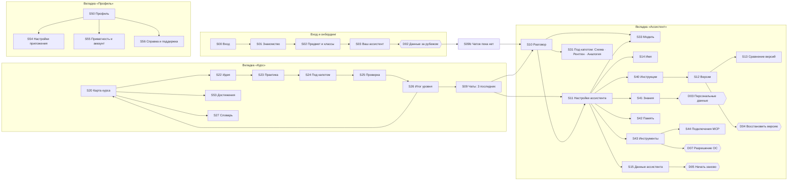

# Craft Builder — user flow и аудит экранов

*17.10.2026 · по макету «Craft Builder — дизайн приложения» (MVP, уровни 1–5)*

> Та же карта нарисована в дизайн-артефакте: первый лист «User flow» (миниатюры экранов и подписанные стрелки). Сам файл — `design/Flow.dc.html`; миниатюры в нём подгружаются из хранилища артефакта и вне его не отображаются.

## 1. Структура приложения

Три вкладки, у каждой своя роль:

| Вкладка | Про что | Корневой экран |
|---|---|---|
| **Ассистент** | Работа с ассистентом и всё, из чего он состоит | S09 Чаты (главная вкладки) |
| **Курс** | Обучение: уровни, шаги урока, достижения, словарь | S20 Карта курса |
| **Профиль** | Я и приложение: аккаунт, расход токенов, настройки, приватность, справка | S50 Профиль |

Правило размещения: если экран меняет **ассистента** (его инструкции, знания, память, инструменты, модель, данные) — он во вкладке «Ассистент». Если про **учителя или приложение** — в «Профиле». Если про **обучение** (прогресс, уровни, достижения, термины) — в «Курсе». У каждого факта один экран-владелец; в других местах он только ссылка.

## 2. Основные сценарии

### F1. Первый запуск
1. **S00 Вход** — вход аккаунтом CraftAI.
2. **S01 Знакомство** — три обещания курса: учите, заглядывайте под капот, знайте, где данные.
3. **S02 Предмет и классы** — ассистент настраивается под предмет.
4. **S03 Ваш ассистент** — пустой персонаж, имя ассистента → «Начать».
5. **D02 Данные за рубежом** — один раз: запросы уходят в облако, не отправляйте данные учеников → «Понятно».
6. **S10 Разговор** — первый диалог.

### F2. Ежедневная работа с ассистентом
1. **S10** — учитель пишет запрос, ассистент отвечает. Под ответом — «Под капотом».
2. Если ассистент хочет что-то сделать (календарь, заметка) — **карточка подтверждения прямо в чате** (Создать / Отмена). Отдельного диалога нет.
3. **S31 Под капотом** — путь запроса (Схема), всё, что увидела модель (Рентген), объяснение на примере (Аналогия).
4. Чип модели в шапке → **S33 Модель** — смена категории.

### F3. Пройти уровень курса
1. **S20 Карта курса** → текущий уровень «Продолжить» (возврат на сохранённый шаг) или пройденный уровень (повтор с начала).
2. **S22 Идея → S23 Практика → S24 Под капотом → S25 Проверка → S26 Итог.**
3. На S26 — «К следующему уровню» (→ S20) или «Попробовать ассистента» (→ S09).
4. × в любом шаге → S20, прогресс сохраняется (тост на S20).

### F4. Настроить ассистента
1. **S10** → имя/иконка настроек в шапке → **S11 Настройки ассистента**.
2. Из S11: Имя (S14) · Инструкции (S40) и Версии (S12, S13, D04) · Знания (S41, D03) · Память (S42) · Инструменты (S43 → S44, D07) · Модель (S33) · Данные ассистента (S15).

### F5. Данные и сброс
1. **S11 → S15 Данные ассистента** — где лежит, что хранить.
2. **«Начать заново» → D05** — единственный сброс: ассистент, версии и прогресс курса возвращаются к началу. Аккаунт CraftAI остаётся.
3. В S55 про данные ассистента только подсказка без ссылки: управлять ими в «Ассистент → Настройки → Данные ассистента».

### F6. Профиль
**S50** показывает аккаунт и расход токенов, дальше: Настройки приложения (S54) · Приватность и аккаунт (S55) · Справка и поддержка (S56) · Выйти (S00). Прогресса курса, достижений и данных ассистента в профиле нет: они в «Курсе» (S20 → S53, S27) и в «Ассистенте» (S11 → S15).

## 3. Аудит экранов

Четыре вопроса к каждому экрану: **нужен ли** · **не дублируется ли** · **на своём ли месте** · **что улучшить в UI/UX**.

| Экран | Нужен? | Дубль? | Место | UI/UX | Решение |
|---|---|---|---|---|---|
| S00 Вход | Да | Нет | Онбординг | Ок | Оставить |
| S01 Знакомство | Да, задаёт ожидания | Нет | Онбординг | Ок | Оставить |
| S02 Предмет и классы | Да | Частично с S54 (правка позже) — это нормально | Онбординг | Ок | Оставить |
| S03 Ваш ассистент | Да | Имя дублирует S14, но S14 — правка позже | Онбординг | «Начать» вела сразу в чат, минуя D02 | **«Начать» → D02 → S10** |
| D02 Данные за рубежом | Да (ТЗ: первый запуск) | Нет | Был «висящим» — никто не вёл | «Не сейчас» вела в выбор модели — непонятно | **Встроить в онбординг, обе кнопки → S09b (чатов ещё нет); перенести на холсте в раздел 1** |
| S10 Разговор | Да, главный экран | Нет | Ассистент | Чип «Данные за рубежом» некликабелен | **Чип → S55 Приватность** |
| D01 Подтверждение действия | Нет | **Да:** та же карточка уже есть в чате S10 | — | Шторка перекрывает ответ, второй слой подтверждения | **Удалить; паттерн — карточка в чате** |
| S11 Настройки ассистента | Да | Нет | Ассистент | Исправлено ранее: прокрутка, Инструменты, Данные | Оставить |
| S12 Версии | Да (приём «сломай и верни») | Нет | Ассистент | Ок | Оставить |
| S13 Сравнение версий | Да | Нет | Ассистент | Ок | Оставить |
| D04 Восстановить версию | Да | Нет | Ассистент | Ок | Оставить |
| S14 Имя ассистента | Да (P1) | Нет | Ассистент | Ок | Оставить |
| D05 Начать заново | Да — единственный сброс | — | Ассистент | Ок | Оставить |
| S15 Данные ассистента | Да | — | Ассистент | Две разрушительные кнопки рядом | **Оставить одну — «Начать заново»** |
| D06 Удалить данные | Нет | **Да:** удаляет то же, что D05 (ассистент, версии, прогресс). Концепция: «один общий сброс» | — | Два почти одинаковых опасных действия путают | **Удалить** |
| S31 Под капотом (3 вкладки) | Да, суть курса | Нет (S24 — урок-версия с акцентом) | Ассистент, слой над S10 | Ок | Оставить |
| S33 Модель | Да | — | Ассистент | «Подробнее» только у одной категории | **Убрать «Подробнее», у всех одинаковые карточки** |
| S34 Карточка категории | Нет (P1) | **Да:** повторяет описание из S33 | — | Лишний уровень вложенности | **Удалить** |
| S41 Знания | Да | Нет | **Не на месте:** стоял в разделе «Под капотом и модели» | Ок | **Перенести на холсте к умениям ассистента (S40, S42, S43)** |
| D03 Персональные данные | Да | Нет | Вместе с S41 | Ок | Перенести вместе с S41 |
| S20 Карта курса | Да | Нет | Курс | Не было входа в достижения и словарь | **Пройденные уровни → S22; текущий «Продолжить» → S23; плитки «Достижения» и «Словарь» под списком уровней** |
| S22 Идея | Да | Нет | Курс | Никто не вёл на экран | Связать с S20 и S23 |
| S23 Практика | Да | Нет | Курс | «Дальше» перескакивала на итог, «Назад» не работала | **«Назад» → S22, «Дальше» → S24** |
| S24 Под капотом (урок) | Да | Нет (акцент на новом модуле) | Курс | Ок | Оставить |
| S25 Проверка | Да | Нет | Курс | Ок | Оставить |
| S26 Итог уровня | Да | Нет | Курс | Ок | Оставить |
| S40 Инструкции | Да | Нет | Ассистент | Ок | Оставить |
| S42 Память | Да | Нет | Ассистент | Ок | Оставить |
| S43 Инструменты | Да | — | Ассистент | Уже показывает режим доступа у каждого инструмента | Оставить |
| S44 Подключения (MCP) | Да | Нет | Ассистент | Кнопка вела на S45 | **Кнопка → «Готово» (S43)** |
| S45 Разрешения | Нет | **Да:** те же инструменты и режимы, что в S43 | — | Третий уровень вложенности ради списка | **Удалить** |
| D07 Разрешение ОС | Да | Нет | Ассистент | Ок | Оставить |
| S50 Профиль | Да | **Да, был:** кольцо прогресса, «Продолжить курс», превью достижений дублировали S20 | Профиль | Профиль превращался в дашборд курса | **Пересобран 17.10: шапка (кто я) + расход токенов аккаунта + 3 пункта (настройки, приватность, справка) + выход** |
| S53 Достижения | Опционально (P2) | Нет | **Не на месте:** награда за обучение стояла в Профиле | Ок | **Перенесён в «Курс», вход с S20, назад → S20, активна вкладка «Курс»** |
| S54 Настройки приложения | Да | Нет | Профиль | Здесь же правка предмета и классов | Оставить; единственное место правки предмета и классов после S02 |
| S55 Приватность и аккаунт | Да | **Да, был:** ссылка на S15 и строка «Прогресс по курсу» | Профиль | Смешивала аккаунт, курс и ассистента | **Только уровень приложения: где хранятся данные, что не отправлять ИИ, скачать данные, удалить аккаунт. Про ассистента — подсказка без ссылки** |
| S56 Справка и поддержка | Да (P1) | **Да, был словарь:** это учебный материал | Профиль | Словарь и FAQ в одном экране | **Только справка: поиск, частые вопросы, «Написать в поддержку»; словарь → S27** |
| S27 Словарь | Да (P1) | Нет | Курс | Новый экран: термины с отметкой уровня | **Добавлен, вход с S20, назад → S20** |

## 4. Итог изменений

- **Удалены 4 экрана-дубля:** D01 (подтверждение в чате), D06 (второй сброс), S34 (описание модели), S45 (разрешения).
- **Исправлены 6 переходов:** S03 → D02 → S10; S20 → S22/S23; S23 → S22/S24; S44 → S43; чип S10 → S55; S33 без «Подробнее».
- **Холст:** D02 — в онбординг; S41 и D03 — к умениям ассистента; ряды без пустот; раздел 3 переименован в «Под капотом и модель».
- **Всего экранов и диалогов MVP:** 36 (было 39 до аудита; +S27 после пересмотра профиля).

## 5. Пересмотр профиля (17.10, вечером)

Причина: в профиле дублировались данные курса (кольцо прогресса, «Продолжить», достижения) и ассистента (ссылка на S15).

| Что | Владелец | В профиле |
|---|---|---|
| Прогресс, уровни, «Продолжить», достижения, словарь | Курс | нет |
| Инструкции, память, знания, инструменты, модель, данные, сброс | Ассистент | нет |
| Имя, e-mail, предмет и классы, расход токенов | Профиль | да |
| Язык, уведомления, шрифт | Профиль (S54) | да |
| Что уходит в облако, экспорт и удаление аккаунта, выход | Профиль (S55) | да |
| Справка и поддержка | Профиль (S56) | да |

Изменения: S50 пересобран; S53 и новый S27 «Словарь» — в «Курсе»; S55 очищен от курса и ассистента; S56 без словаря; на S20 добавлены плитки входа.

## Вкладка «Ассистент»: экран-хаб S09

Вкладка «Ассистент» открывается на **S09**: иконка ассистента (→ имя и «Настройки ассистента» ведут в S11), три последних чата и кнопка «Новый чат». Тап по чату или «Новый чат» → **S10 Чат**; «назад» из S10 и из S11 → S09. Если чатов нет (первый запуск после онбординга), показывается **S09b** с пояснением вместо списка. Кнопки D02 ведут в S09b.
